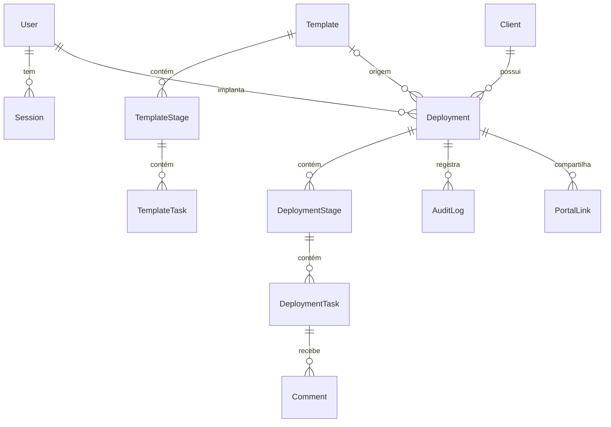

# Trilha: acompanhamento de implantação de clientes

Plataforma web que uma software house pequena usa para conduzir a implantação do seu sistema nos clientes: etapas, prazos, responsáveis, progresso e um painel que mostra o que está atrasado. O problema que resolve: implantações em planilha e WhatsApp, em que o atraso aparece tarde, o combinado com o cliente se perde e cada implantação segue um roteiro diferente.


## Diferenciais

- **Atraso da equipe separado da espera do cliente.** O painel não culpa o implantador por algo que depende do cliente.
- **Prazos relativos ao kickoff (D+n).** O modelo gera as datas reais; mudar o modelo depois não altera o que já foi combinado.
- **Histórico de alterações.** Toda mudança de prazo, status ou responsável registra quem fez e o motivo, na mesma transação.
- **Portal do cliente por link com token**, somente leitura e sem cadastro. O banco guarda só o hash do token; o link expira e pode ser revogado.
- **Autorização no servidor** por papel (administrador e implantador), com teste do caso negado.
- **Regras de negócio em funções puras**, testadas contra PostgreSQL real nos serviços.

## O que é simulado e o que não foi validado

- **A Rota Fácil Software, as pessoas e os clientes são fictícios.** Modelei o cenário para desenvolver o projeto. Usei o Claude (Anthropic) de duas formas: como assistente de desenvolvimento e como ator nas reuniões, interpretando fundador, líder, implantador, suporte e cliente a partir do meu briefing. Por isso as reuniões em `docs/` estão marcadas como simuladas.
- **Não há usuários reais nem resultado medido.** Números de ganho aparecem só como hipótese ou meta.
- **Não está hospedado.** O projeto roda localmente; qualquer pessoa o executa com os comandos abaixo.
- **O CI (GitHub Actions) está configurado, mas ainda não foi executado no GitHub.** O que registrei foram as execuções locais.
- Não validei: Firefox, Safari e celular físico; acessibilidade além das regras automáticas do axe; desempenho e carga; cobertura de código (não medida). Lista completa em [limitações conhecidas](docs/05-qualidade/03-limitacoes-conhecidas.md).

## Veja o produto

**1. Login.** Entrada por e-mail e senha, com sessão própria no banco. Escolhi não usar Auth.js para ter logout e desativação imediatos com pouco código que eu consiga explicar ([ADR-002](docs/03-arquitetura/adr/002-autenticacao.md)).


**2. Painel.** O que está atrasado, de quem e há quanto tempo, com a espera do cliente em outra cor e a fila de pendências por implantador. O "tempo médio" é calculado só sobre os dados de demonstração.


**3. Minhas pendências.** A fila pessoal de cada implantador, com as atrasadas primeiro. É o benefício imediato de preencher o sistema, o que ataca o risco de a equipe não usá-lo.


**4. Nova implantação.** O cliente, o modelo e o kickoff geram uma prévia das datas reais (D+n) antes de criar. Depois de criada, a implantação é uma cópia e não muda se o modelo mudar ([ADR-004](docs/03-arquitetura/adr/004-tarefas-e-prazos-relativos.md)).


**5. Detalhe da implantação.** Status por tarefa, prazo com o original e o motivo do ajuste, comentários internos e o painel do link do cliente. Só o responsável altera; os demais comentam.


**6. Histórico.** Quem mudou o quê e por quê. A auditoria é gravada na mesma transação da mudança, então não há alteração sem registro ([ADR-005](docs/03-arquitetura/adr/005-auditoria.md)).


**7. Modelo de implantação.** Etapas e tarefas com prazo D+n, responsável padrão, obrigatoriedade e visibilidade ao cliente. Editar o modelo não afeta as implantações já criadas.


**8. Clientes.** Cadastro de empresa, contato, plano e data de contrato. Cliente com implantação em andamento não pode ser arquivado.


**9. Portal do cliente.** Progresso e próximas etapas, sem comentários nem tarefas internas. Recusei escrita no portal: o link não tem login e isso comprometeria o dado que o fundador usa para decidir ([ADR-007](docs/03-arquitetura/adr/007-portal-por-token.md)).


**10. Portal no celular.** O cliente abre o link no WhatsApp, então o portal foi desenhado para 360 px. Um teste E2E garante que não há rolagem horizontal.


**11. Painel no celular.** O mesmo painel reorganizado em uma coluna, para o líder consultar fora da mesa.


Os prints são gerados pelo Playwright sobre dados de exemplo, em um banco separado (`npm run screenshots`).

## Como funciona


- **Páginas e Server Actions** (`src/app`): finas; autenticam, chamam o serviço e revalidam.
- **Serviços** (`src/server/services`): cada caso de uso valida com Zod, autoriza, grava e audita numa transação ([ADR-008](docs/03-arquitetura/adr/008-camada-de-servicos.md)).
- **Domínio puro** (`src/domain`): cálculo de prazo, atraso, progresso, permissões e token do portal, sem framework nem banco.
- **PostgreSQL com Prisma**, migrations versionadas ([modelo de dados](docs/03-arquitetura/modelo-de-dados.md)).



## O que tem em cada pasta

| Pasta | O que é |
|---|---|
| [`src/app`](src/app) | Páginas, Server Actions e o healthcheck |
| [`src/server`](src/server) | Serviços, sessão, senha, auditoria e dados de exemplo |
| [`src/domain`](src/domain) | Regras puras: prazos, atraso, progresso, permissões |
| [`src/components`](src/components) | Componentes de interface |
| [`prisma`](prisma) | Schema, migration, seed e script de redefinição de senha |
| [`tests`](tests) | Unitários, integração (PostgreSQL real), E2E e geração dos prints |
| [`docs`](docs) | Toda a documentação do projeto, por etapa (tabela abaixo) |
| [`docs/imagens`](docs/imagens) | Prints reais das telas |
| [`.github/workflows`](.github/workflows) | CI: lint, tipos, testes e build |

## Documentação

| Etapa | Documentos |
|---|---|
| Sobre | [Cenário e ordem de leitura](docs/00-sobre-o-projeto/README.md) |
| Discovery | [Brainstorm](docs/01-discovery/01-brainstorm-e-escolha.md) · [Empresa](docs/01-discovery/02-empresa-rota-facil.md) · [Personas](docs/01-discovery/03-stakeholders-e-personas.md) · [Reunião 1](docs/01-discovery/04-reuniao-1-kickoff-fundador.md) · [Reunião 2](docs/01-discovery/05-reuniao-2-lideranca-e-implantador.md) · [Reunião 3](docs/01-discovery/06-reuniao-3-suporte-e-cliente.md) · [Processo AS-IS](docs/01-discovery/07-processo-as-is.md) · [Problemas priorizados](docs/01-discovery/08-problemas-priorizados.md) |
| Definição | [Visão e metas](docs/02-definicao/01-visao-e-metas.md) · [Requisitos](docs/02-definicao/02-requisitos.md) · [Regras de negócio](docs/02-definicao/03-regras-de-negocio.md) · [Histórias](docs/02-definicao/04-historias-de-usuario.md) · [Priorização e escopo](docs/02-definicao/05-priorizacao-e-escopo.md) · [Backlog e sprints](docs/02-definicao/06-backlog-e-sprints.md) · [Riscos](docs/02-definicao/07-riscos.md) · [Rastreabilidade](docs/02-definicao/08-rastreabilidade.md) · Reviews das sprints [1](docs/02-definicao/sprint-1-review.md), [2](docs/02-definicao/sprint-2-review.md) e [3](docs/02-definicao/sprint-3-review.md) |
| Arquitetura | [Contexto e componentes](docs/03-arquitetura/contexto-e-componentes.md) · [Modelo de dados](docs/03-arquitetura/modelo-de-dados.md) · [Segurança e privacidade](docs/03-arquitetura/seguranca-e-privacidade.md) |
| Protótipo | [Wireframes](docs/04-prototipo/01-wireframes.md) · [Reunião 4 (validação)](docs/04-prototipo/02-reuniao-4-validacao.md) · [Change-log](docs/04-prototipo/03-change-log.md) |
| Qualidade | [Estratégia de testes](docs/05-qualidade/01-estrategia-de-testes.md) · [Resultado da última execução](docs/05-qualidade/02-resultado-da-ultima-execucao.md) · [Limitações](docs/05-qualidade/03-limitacoes-conhecidas.md) · [UAT (reunião 5)](docs/05-qualidade/04-reuniao-5-uat.md) |
| Treinamento e rollout | [Plano de rollout](docs/06-treinamento-e-rollout/01-plano-de-rollout.md) · [Checklist de entrada em uso](docs/06-treinamento-e-rollout/02-checklist-de-entrada-em-uso.md) · [Guia do implantador](docs/06-treinamento-e-rollout/04-guia-treinamento-implantador.md) · [Guia do cliente](docs/06-treinamento-e-rollout/05-guia-rapido-cliente.md) · [Comunicação](docs/06-treinamento-e-rollout/06-plano-de-comunicacao.md) |
| Operação e evolução | [Runbook](docs/07-pos-go-live/runbook.md) · [Indicadores propostos](docs/07-pos-go-live/indicadores.md) · [Retrospectiva (reunião 6)](docs/07-pos-go-live/reuniao-6-retrospectiva.md) · [Retrospectiva final](docs/07-pos-go-live/retrospectiva-final.md) · [Roadmap](docs/07-pos-go-live/roadmap.md) · [v1.1.0](docs/07-pos-go-live/pr-v1.1.0.md) · [CHANGELOG](CHANGELOG.md) |
| Entrevista | [Perguntas e respostas por fase](docs/entrevista/) |
| Vitrine | [Apresentação](docs/vitrine/apresentacao-do-projeto.md) · [Currículo e LinkedIn](docs/vitrine/curriculo-e-linkedin.md) |

## Decisões de arquitetura (ADRs)

| ADR | Decisão |
|---|---|
| [001](docs/03-arquitetura/adr/001-framework.md) | Next.js (App Router) com TypeScript, um projeto só para interface e regras |
| [002](docs/03-arquitetura/adr/002-autenticacao.md) | Sessão própria no banco, senha com scrypt, em vez de Auth.js |
| [003](docs/03-arquitetura/adr/003-banco-e-orm.md) | PostgreSQL com Prisma e migrations versionadas |
| [004](docs/03-arquitetura/adr/004-tarefas-e-prazos-relativos.md) | Modelo copiado para a implantação; prazo relativo (D+n) com datas civis |
| [005](docs/03-arquitetura/adr/005-auditoria.md) | Auditoria gravada na mesma transação da mudança |
| [006](docs/03-arquitetura/adr/006-controle-de-acesso.md) | Papéis e autorização central no servidor |
| [007](docs/03-arquitetura/adr/007-portal-por-token.md) | Portal do cliente por token opaco, hash no banco, somente leitura |
| [008](docs/03-arquitetura/adr/008-camada-de-servicos.md) | Camada de serviços com validação, autorização e auditoria |

## Qualidade

Executei em 2026-10-23, nesta máquina, com `npm run lint`, `npm run typecheck`, `npm test`, `npm run build` e `npx playwright test`:

| Verificação | Resultado |
|---|---|
| Lint e tipos | sem erros |
| Testes unitários | 52 passaram |
| Testes de integração (PostgreSQL real) | 70 passaram |
| Testes E2E (Chromium, inclui acessibilidade com axe) | 34 passaram |
| **Total** | **156 testes passando** |
| Build | compilou |

Defeitos reais encontrados e corrigidos durante a construção estão no [resultado da execução](docs/05-qualidade/02-resultado-da-ultima-execucao.md) (por exemplo, rolagem horizontal no celular em `/clientes`).

**O que não foi validado:** o CI no GitHub (ainda não executado); outros navegadores além do Chromium; celular físico; acessibilidade manual (teclado e leitor de tela); desempenho; cobertura de código (não medida, não vou inventar um percentual); uso por pessoas reais.

## Como rodar localmente

Pré-requisitos: Node.js 24 (versão com que desenvolvi e testei) e Docker.

```bash
npm install
cp .env.example .env     # os valores padrão já servem para o ambiente local
npm run setup            # sobe o PostgreSQL (Docker), aplica as migrations e carrega os dados de exemplo
npm run dev              # http://localhost:3000
```

Contas de demonstração, criadas pelo seed (dados fictícios, só para uso local):

| Papel | E-mail | Senha |
|---|---|---|
| Administrador | `admin@rotafacil.example` | `Admin-Trilha-2026` |
| Implantador | `implantador@rotafacil.example` | `Usuario-Trilha-2026` |

O link do cliente é gerado dentro de uma implantação, no botão "Gerar link do cliente". Para testar:

```bash
npm run lint && npm run typecheck && npm test   # unitários e integração (cria o banco trilha_test)
npm run build && npx playwright install chromium && npx playwright test   # E2E (cria o banco trilha_e2e)
npm run screenshots                              # regenera docs/imagens
```

## Licença

[MIT](LICENSE). João Gabriel Maia da Costa.
