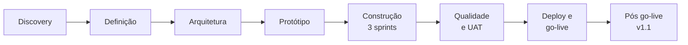
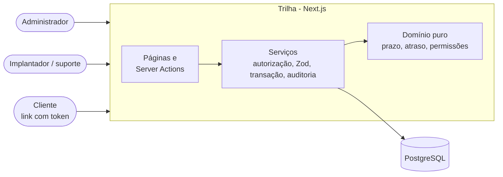
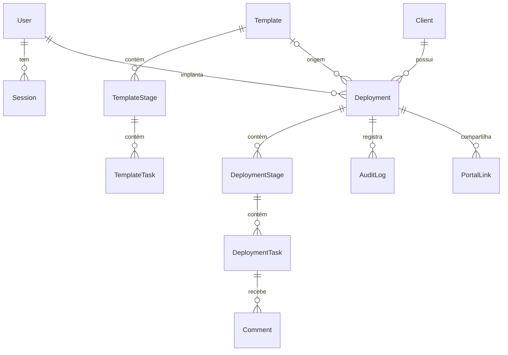
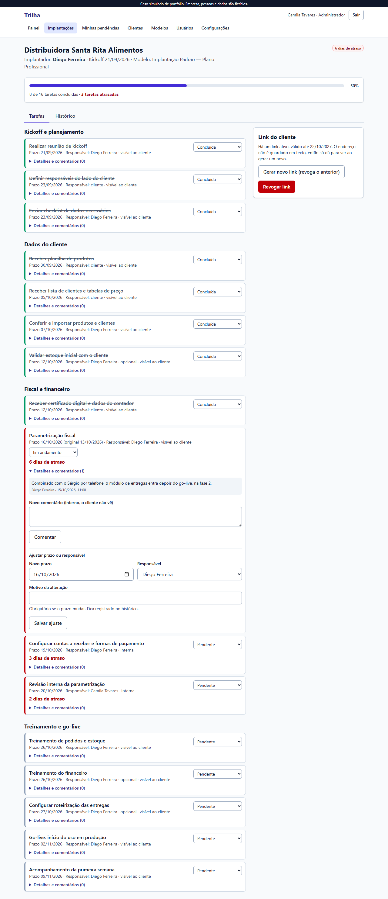
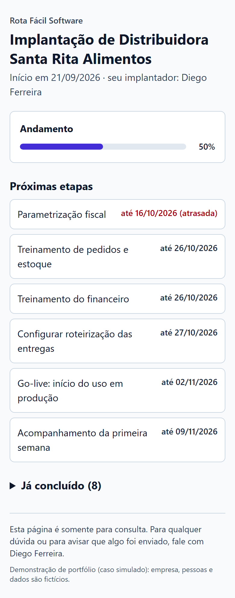

# Trilha: acompanhamento de implantação de clientes

> ## ⚠️ Caso simulado de portfólio. Empresa, pessoas e dados são fictícios.
> A "Rota Fácil Software", as pessoas, os clientes e todos os dados deste repositório são inventados por mim. Reuniões, entrevistas, o UAT e o piloto são **roteirizados** e estão marcados como tal. **Não existe uso real com clientes**, e o sistema fica publicado como **demonstração**. Os números de teste abaixo são os que saíram do meu terminal.

| | |
|---|---|
| 🔗 **Demonstração** | `[PREENCHER: URL da demonstração, depois do deploy]` |
| 🧪 **Contas de demonstração** (públicas, fictícias) | Administrador: `admin@rotafacil.example` · `Demo-Admin-2026` <br> Implantador: `implantador@rotafacil.example` · `Demo-Implantador-2026` |
| 👤 **Link de cliente de demonstração** | `<URL da demonstração>/p/demo-portal-santa-rita-token-publico-0001` |
| 🚦 **CI** | `[PREENCHER: selo do GitHub Actions depois de enviar o repositório]` (o workflow existe, mas **ainda não foi executado no GitHub**) |
| 🎬 **Vídeo de 2 minutos** | `[PREENCHER: link, depois de gravar]` (o [roteiro](docs/06-deploy-e-go-live/03-roteiro-video-demo.md) está pronto) |

> Se alguém gerar um novo link para a implantação da Santa Rita, o link de cliente acima é revogado (é o comportamento correto). A demo é recarregada pelo seed.


## Resumo

- **Problema:** uma software house pequena conduz implantações em planilha e WhatsApp; descobre atrasos tarde, perde o que combinou com o cliente e cada implantação segue um roteiro diferente.
- **Solução:** a Trilha cria a implantação a partir de um modelo, calcula os prazos a partir do kickoff, separa o atraso da equipe da espera do cliente e dá ao cliente um link de leitura, sem cadastro.
- **Para quem:** fundador e líder (painel), implantadores e suporte (tarefas, comentários, histórico) e o cliente (portal).
- **Stack:** Next.js 16 (App Router) + TypeScript, Tailwind CSS 4, Prisma 7 + PostgreSQL, Zod, Vitest e Playwright.
- **Status:** v1.1.0 funcionando localmente; **preparado para publicar** (guia pronto), mas a publicação depende das minhas contas e **ainda não foi feita**.

## Como o projeto foi conduzido

Do discovery à v1.1, cada etapa tem uma pasta de documentos. Os ADRs, o modelo de dados e a matriz de rastreabilidade ligam o "porquê" ao código e ao teste.



| Etapa | O que fiz | Onde |
|---|---|---|
| 0. Sobre o caso | O que é real e o que é simulado; como ler | [`00-sobre-este-caso`](docs/00-sobre-este-caso/README.md) |
| 1. Discovery | Brainstorm e escolha; empresa fictícia; personas; 3 reuniões simuladas; processo AS-IS; problemas priorizados | [`01-discovery`](docs/01-discovery/) |
| 2. Definição | Visão, RF/RNF/RN, histórias com Dado/Quando/Então, MoSCoW, backlog em 3 sprints, riscos, rastreabilidade | [`02-definicao`](docs/02-definicao/) |
| 3. Arquitetura | 9 ADRs, modelo de dados, contexto e componentes, segurança e privacidade, custo | [`03-arquitetura`](docs/03-arquitetura/) |
| 4. Protótipo | Wireframes, reunião 4 e change-log (inclui uma **recusa justificada**) | [`04-prototipo`](docs/04-prototipo/) |
| 5. Implementação | 3 sprints, commits por história com ID | [`sprint reviews`](docs/02-definicao/sprint-1-review.md) |
| 6. Qualidade | Estratégia, resultado real, limitações, UAT com defeitos reais | [`05-qualidade`](docs/05-qualidade/) |
| 7 e 8. Deploy e go-live | Guia de deploy, ações manuais, rollout, rollback, treinamento, roteiro de vídeo | [`06-deploy-e-go-live`](docs/06-deploy-e-go-live/) |
| 9. Pós go-live | Runbook, indicadores propostos, retrospectiva, **v1.1.0**, roadmap | [`07-pos-go-live`](docs/07-pos-go-live/) · [CHANGELOG](CHANGELOG.md) |
| Entrevista | 3 perguntas e respostas por fase | [`entrevista`](docs/entrevista/) |
| Vitrine | Texto para currículo, LinkedIn e apresentação | [`vitrine`](docs/vitrine/) |

## As 5 decisões mais importantes e seus trade-offs

| # | Decisão | O que ganhei | O que perdi | Detalhe |
|---|---|---|---|---|
| 1 | **Separar atraso da equipe e espera do cliente** | Painel que não gera discussão toda segunda; mostra os dois | Regra mais difícil de explicar que "venceu, atrasou" (por isso tem testes de borda) | [RN-02, RN-03](docs/02-definicao/03-regras-de-negocio.md) |
| 2 | **Copiar o modelo para a implantação** e usar prazo relativo (D+n) com datas civis | O combinado com o cliente não muda se o modelo mudar; sem bug de fuso | Duplicação de dados; corrigir o modelo não corrige o que está em andamento | [ADR-004](docs/03-arquitetura/adr/004-tarefas-e-prazos-relativos.md) |
| 3 | **Sessão própria** em vez de Auth.js | Desativação e logout imediatos; poucas linhas que sei explicar | Eu respondo pelos detalhes de segurança; sem login social | [ADR-002](docs/03-arquitetura/adr/002-autenticacao.md) |
| 4 | **Portal por token opaco** (hash no banco, expira, revoga) e **somente leitura** | Cliente sem conta; vazamento do banco não entrega links; recusei escrita no portal | Quem tem o link acessa; sem botão "já enviei" | [ADR-007](docs/03-arquitetura/adr/007-portal-por-token.md), [CH-04](docs/04-prototipo/03-change-log.md) |
| 5 | **Camada de serviços** com autorização, validação e auditoria na mesma transação, testada contra PostgreSQL real | Regra de negócio testável sem Next; nada de mudança sem registro | Uma camada a mais; testes de integração mais lentos | [ADR-005, 006, 009](docs/03-arquitetura/adr/) |

## Arquitetura



### Modelo de dados (resumo)



Explicação completa das escolhas: [modelo de dados](docs/03-arquitetura/modelo-de-dados.md) e [segurança e privacidade](docs/03-arquitetura/seguranca-e-privacidade.md).

## Funcionalidades

**Painel:** o que está atrasado, de quem e há quanto tempo, com a espera do cliente separada.


**Detalhe da implantação:** status, prazo com motivo, comentários internos e histórico.



**Modelo de implantação:** etapas e tarefas com prazo relativo (D+n), responsável padrão, obrigatoriedade e visibilidade ao cliente.


**Portal do cliente (celular):** progresso e o que depende do cliente, sem comentários nem tarefas internas.



Outras telas: [login](docs/screenshots/01-login.png), [minhas pendências](docs/screenshots/03-minhas-pendencias.png), [nova implantação com prévia](docs/screenshots/04-nova-implantacao.png), [histórico](docs/screenshots/06-historico.png), [clientes](docs/screenshots/08-clientes.png), [painel no celular](docs/screenshots/11-painel-mobile.png). Os prints são gerados pelo Playwright com os dados de demonstração (`npm run screenshots`).

**Lista completa:** login e papéis · clientes · usuários · modelos · implantações com prazos calculados · status, prazo e responsável por tarefa · comentários · histórico de alterações · painel e filtros · fila de pendências · regra de atraso configurável · link do cliente com mensagem pronta · exportação em CSV (v1.1) · healthcheck.

## Como rodar localmente

Pré-requisitos: Node.js 24 (a versão com que desenvolvi e testei) e Docker.

```bash
git clone <url-do-repositório> && cd <pasta>
npm install                 # também gera o cliente Prisma (postinstall)
cp .env.example .env        # os valores padrão já servem para o ambiente local
docker compose up -d        # PostgreSQL local na porta 5433
npx prisma migrate deploy   # cria as tabelas
npm run db:seed             # dados de demonstração (fictícios)
npm run dev                 # http://localhost:3000
```

Entre com as contas da tabela do topo.

## Como testar

```bash
npm run lint
npm run typecheck
npm run test:unit            # regras puras, sem banco
npm run test:integration     # serviços contra PostgreSQL real (cria o banco trilha_test)
npm run build
npx playwright install chromium   # só na primeira vez
npx playwright test          # E2E sobre o app compilado (cria o banco trilha_e2e)
npm run screenshots          # regenera docs/screenshots
```

## Como publicar (demonstração)

Passo a passo em [`docs/06-deploy-e-go-live/deploy.md`](docs/06-deploy-e-go-live/deploy.md) (Vercel + Neon) e a lista do que depende de contas minhas em [`acoes-manuais.md`](docs/06-deploy-e-go-live/acoes-manuais.md).

## Qualidade

Última execução local, **v1.1.0** (detalhes e histórico em [`docs/05-qualidade`](docs/05-qualidade/02-resultado-da-ultima-execucao.md)):

| Verificação | Resultado |
|---|---|
| Lint e tipos | sem erros |
| Testes unitários | 52 passaram |
| Testes de integração (PostgreSQL real) | 70 passaram |
| Testes E2E (Chromium, inclui 6 de acessibilidade com axe) | 34 passaram |
| **Total** | **156 testes passando** |

- **CI:** GitHub Actions com lint, tipos, unitários, integração (Postgres como serviço), build e E2E. **Ainda não foi executado no GitHub**; quando eu enviar o repositório, o primeiro resultado real entra aqui, passando ou não.
- **Cobertura de código:** não medida (não vou inventar um percentual). A rastreabilidade regra → teste está em [`08-rastreabilidade`](docs/02-definicao/08-rastreabilidade.md).
- **Defeitos reais** encontrados e corrigidos durante a construção estão no [resultado da execução](docs/05-qualidade/02-resultado-da-ultima-execucao.md) (por exemplo, rolagem horizontal no celular em `/clientes`).

## Limitações e roadmap

Limitações completas em [`03-limitacoes-conhecidas`](docs/05-qualidade/03-limitacoes-conhecidas.md). As principais: demonstração sem uso real; sem notificações; sem feriados no cálculo de prazo; sem dependência entre tarefas; sem limite de tentativas de login; acessibilidade só com verificação automática; apenas Chromium testado.

Roadmap ([`roadmap.md`](docs/07-pos-go-live/roadmap.md)): **v1.2** alerta de atraso por e-mail, recuperação de senha, concluir tarefas em lote, feriados. **v2** dependência entre tarefas, "já enviei" com confirmação por e-mail, anexos e subtarefas, integração com CRM/ERP, multiempresa.

## O que este projeto demonstra sobre mim

**Neste caso simulado** (verificável no repositório):

1. **Descobrir o problema e refinar pedido vago:** o discovery transforma "painel bonito" em requisito e documenta contradições e restrições que mudaram o escopo.
2. **Definir escopo e dizer não:** requisitos rastreáveis, MoSCoW, fora do escopo com motivo e uma recusa justificada ao cliente.
3. **Decidir e justificar tecnicamente:** 9 ADRs com alternativas, trade-offs e quando eu mudaria de ideia.
4. **Construir e testar com rigor:** regras de negócio em funções puras, autorização no servidor, auditoria transacional e 156 testes passando, com os defeitos reais registrados.
5. **Levar ao uso e evoluir:** treinamento, plano de rollout e rollback, runbook, retrospectiva e uma evolução real (v1.1.0) com changelog.

**Como isso se conecta à minha experiência real:**

`[ESPAÇO PARA EU PREENCHER: como isso se conecta à minha experiência real. Não escrevi de propósito: só eu sei o que é verdade.]`

## Licença

[MIT](LICENSE). Projeto de portfólio de João Gabriel Maia da Costa.
