# Trilha

Acompanhamento de implantação de clientes: modelos com prazos D+n, painel que separa atraso da equipe de espera do cliente, auditoria na mesma transação e portal por link.

**Sumário:** [Problema](#o-problema) · [Ficha técnica](#ficha-técnica) · [Ciclo de vida](#ciclo-de-vida-do-discovery-à-evolução) · [Scrum](#scrum-e-planejamento) · [Requisitos](#requisitos-e-rastreabilidade) · [Arquitetura](#arquitetura-e-decisões-técnicas) · [Dados](#modelo-de-dados) · [Testes](#estratégia-de-testes-e-evidências) · [Implantação](#implantação-operação-e-adoção) · [Configuração](#gestão-de-configuração-e-evolução) · [Competências](#competência--prova) · [Limites](#limites-riscos-e-evolução-prevista) · [Documentos](#documentos-complementares) · [Nota de contexto](#nota-de-contexto-acadêmico)

## O problema

Cenário fictício: a Rota Fácil Software, software house de cerca de 12 pessoas, implanta o sistema nos clientes com planilhas e WhatsApp.
O fundador descobre o atraso quando o cliente liga, e os combinados feitos no WhatsApp se perdem. Cada implantador segue um roteiro próprio, na própria planilha.
O discovery chegou a sete problemas priorizados, cada um com a evidência da fala que o originou: [problemas priorizados](docs/01-discovery/08-problemas-priorizados.md).

<table>
  <tr>
    <td>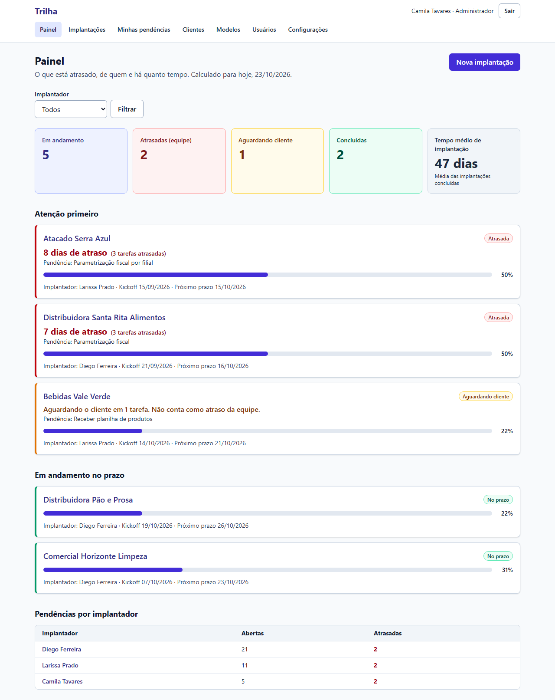</td>
    <td>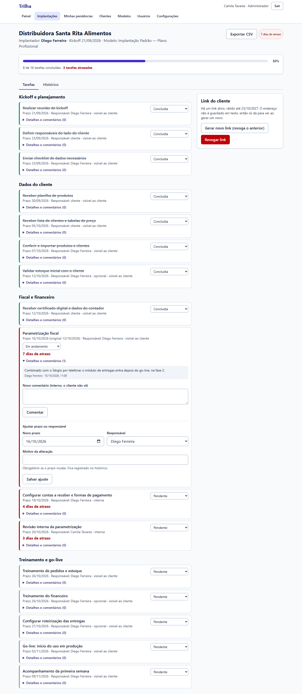</td>
  </tr>
  <tr>
    <td>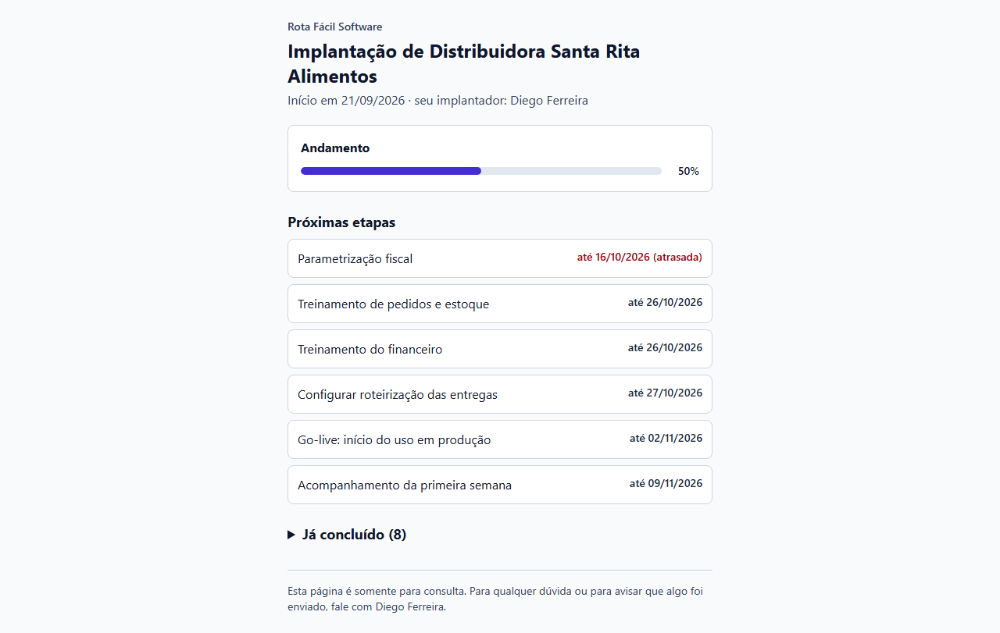</td>
    <td>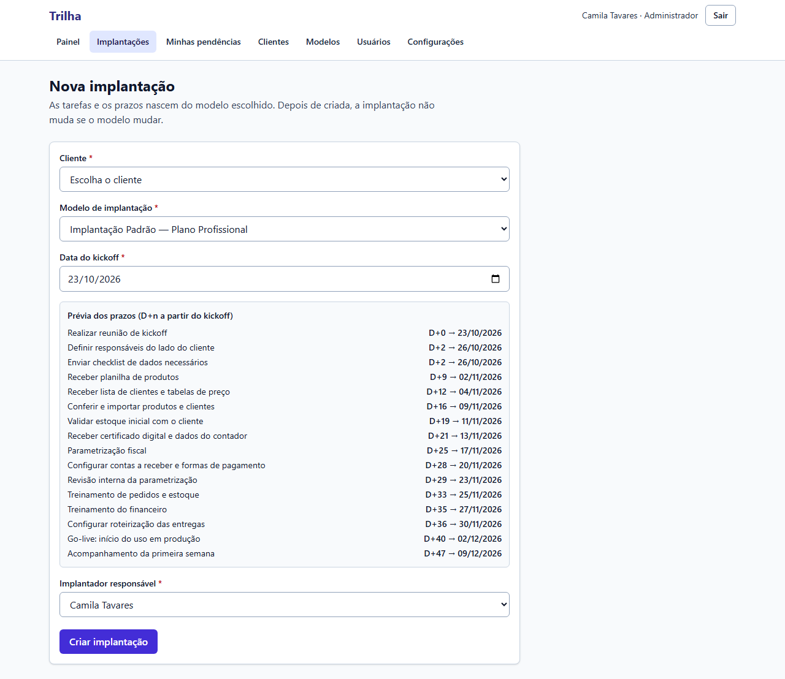</td>
  </tr>
</table>

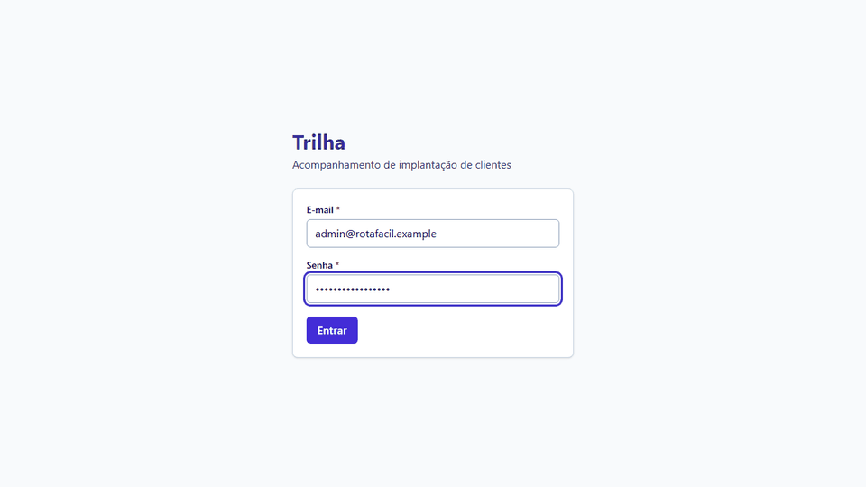

Gravação de cerca de 20 s do fluxo real, com o app em build local e dados do seed. Todas as telas, na ordem de uso, estão na [galeria com 14 telas](docs/imagens/README.md).

## Ficha técnica

| Campo | Informação |
|---|---|
| Natureza | Estudo de caso fictício |
| Stack | Next.js 16 (App Router), React 19, TypeScript, Tailwind CSS 4, Prisma 7, PostgreSQL, Zod |
| Testes | 156 passando (Vitest e Playwright) na CI em 2026-10-24, commit `a9066fe`, [run 40099053410](https://github.com/Joaogabrielmaia/Customer-onboarding-platform/actions/runs/40099053410) |
| Versões | v1.0.0 e v1.1.0, tags de 2026-10-22; [CHANGELOG](CHANGELOG.md) |

## O que construí

- Modelei a implantação como uma cópia do modelo, com prazos D+n contados a partir do kickoff; mudar o modelo depois não altera o que já foi combinado ([ADR-004](docs/03-arquitetura/adr/004-tarefas-e-prazos-relativos.md), prévia dos prazos em [nova implantação](docs/imagens/04-nova-implantacao.png)).
- Implementei o painel que separa atraso da equipe de espera do cliente, com filtro por implantador e fila de pendências ([painel](docs/imagens/02-painel.png)).
- Construí o portal do cliente por token opaco: 32 bytes aleatórios, só o SHA-256 no banco, somente leitura, com expiração e revogação ([ADR-007](docs/03-arquitetura/adr/007-portal-por-token.md)).
- Gravei a auditoria na mesma transação da mudança, para não existir alteração sem registro ([ADR-005](docs/03-arquitetura/adr/005-auditoria.md), [histórico](docs/imagens/06-historico.png)).
- Conduzi a validação do protótipo e registrei três pedidos aceitos, um recusado e quatro adiados; o filtro por implantador subiu para Must ([change-log](docs/04-prototipo/03-change-log.md)).
- Entreguei na v1.1.0 a exportação do relatório em CSV, com neutralização de injeção de fórmula ([CHANGELOG](CHANGELOG.md)).

## Ciclo de vida: do discovery à evolução

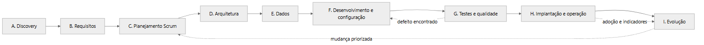

| Fase | O que mostra | Documento |
|---|---|---|
| A. Discovery | Contexto, partes interessadas, problema, escopo, restrições e critérios de sucesso | [01](docs/ciclo-de-vida/01-visao-e-discovery.md) |
| B. Requisitos | 20 RF, 12 RNF, 18 RN e 14 US, com RACI, MoSCoW e rastreabilidade | [03](docs/ciclo-de-vida/03-requisitos-e-rastreabilidade.md) |
| C. Planejamento | Product Goal, backlog, release plan e cinco sprints | [02](docs/ciclo-de-vida/02-planejamento-e-scrum.md) |
| D. Arquitetura | Contexto, contêineres, sequências, estados e oito ADRs | [04](docs/ciclo-de-vida/04-arquitetura-e-adrs.md) |
| E. Dados | ER, dicionário, índices, migration e seed | [05](docs/ciclo-de-vida/05-modelo-de-dados.md) |
| F. Desenvolvimento | Branches, versões, CI, configuração e dívida técnica | [06](docs/ciclo-de-vida/06-desenvolvimento-e-configuracao.md) |
| G. Qualidade | Pirâmide de testes, defeitos D1 a D6 e a falha da CI | [07](docs/ciclo-de-vida/07-testes-e-qualidade.md) |
| H. Implantação | Rollout, rollback, treinamento, operação e adoção | [08](docs/ciclo-de-vida/08-implantacao-e-operacao.md) |
| I. Evolução | Versões, mudanças, roadmap e lições | [09](docs/ciclo-de-vida/09-evolucao-e-roadmap.md) |

### Linha do tempo e marcos

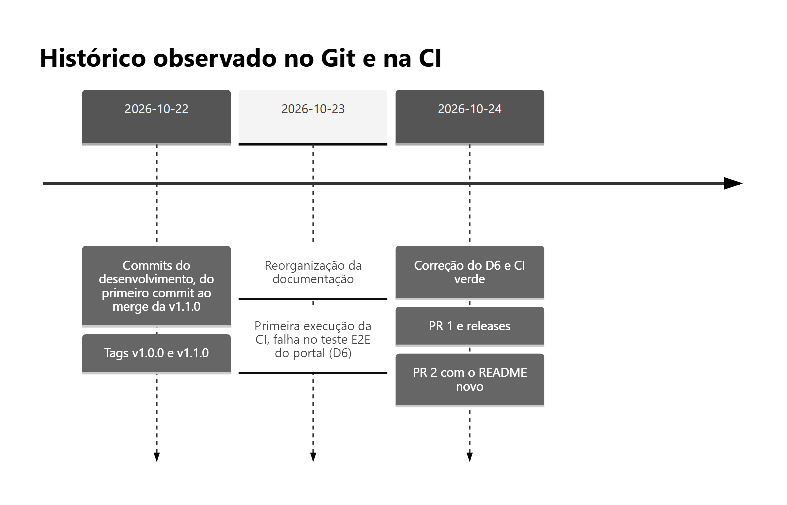

| Data | Marco | Registro |
|---|---|---|
| 2026-10-22 | v1.0.0 e v1.1.0 marcadas | Tags `v1.0.0` (`e71efb7`) e `v1.1.0` (`a16b9bf`) |
| 2026-10-23 | Primeira execução da CI, com falha no E2E do portal (D6) | [Run 39984884953](https://github.com/Joaogabrielmaia/Customer-onboarding-platform/actions/runs/39984884953) |
| 2026-10-24 | D6 corrigido e CI verde | [Run 40098547445](https://github.com/Joaogabrielmaia/Customer-onboarding-platform/actions/runs/40098547445) |

O cronograma acadêmico das sprints está em [docs/ciclo-de-vida](docs/ciclo-de-vida/README.md#linha-do-tempo) e não corresponde às datas dos commits.

## Scrum e planejamento

Product Goal: dar à equipe de implantação uma visão única das implantações, com o atraso da equipe separado da espera do cliente, e dar ao cliente um portal sem cadastro, dentro de cerca de R$ 100/mês e de um desenvolvedor.

| Sprint | Objetivo | Histórias | Registro |
|---|---|---|---|
| [1 Fundação](docs/ciclo-de-vida/sprints/sprint-1-fundacao.md) | Login com papéis, clientes, usuários e seed base | US-01 a US-03 | Commits `e17e719`, `b1cb861`, `1761ad8`, `5705d29` |
| [2 Núcleo](docs/ciclo-de-vida/sprints/sprint-2-nucleo.md) | Modelo, implantação, tarefas, comentários e auditoria | US-04 a US-08 | Commits `72d6907`, `e57bb2c`, `feca826` |
| [3 Visão e cliente](docs/ciclo-de-vida/sprints/sprint-3-visao-e-cliente.md) | Painel, atraso, pendências e portal por token | US-09 a US-14 | Commits `dcbfb74`, `d911d39` |
| [4 Qualidade e prontidão](docs/ciclo-de-vida/sprints/sprint-4-qualidade.md) | CI, E2E, defeitos, UAT e planos de entrada em uso | RNF-06, RNF-07, RNF-11 | Commits `d103eb3`, `4aa7a7a`, `731ea04`, `e71efb7` |
| [5 Evolução v1.1](docs/ciclo-de-vida/sprints/sprint-5-evolucao.md) | Exportação em CSV | RF-20 | Commits `a2da0bc`, `fc42c5c`, `a16b9bf` |

Backlog priorizado, release plan, cerimônias e critérios de repriorização: [02 Planejamento e Scrum](docs/ciclo-de-vida/02-planejamento-e-scrum.md).

### Reuniões e decisões com o cliente

| Reunião (simulada) | Decisão | Ata |
|---|---|---|
| 1. Fundador | WhatsApp automático fora do MVP; entra o portal por link | [Ata](docs/01-discovery/04-reuniao-1-kickoff-fundador.md) |
| 2. Líder e implantador | Estado "aguardando cliente" separado do atraso | [Ata](docs/01-discovery/05-reuniao-2-lideranca-e-implantador.md) |
| 3. Suporte e cliente | Portal sem cadastro | [Ata](docs/01-discovery/06-reuniao-3-suporte-e-cliente.md) |
| Planejamento do release | Cinco sprints e critérios de corte | [Ata](docs/ciclo-de-vida/reunioes/ata-planejamento-do-release.md) |
| 4. Validação do protótipo | Três pedidos aceitos, um recusado, quatro adiados | [Ata](docs/04-prototipo/02-reuniao-4-validacao.md) |
| 5. UAT | Critérios executados; D3 e D4 corrigidos | [Ata](docs/05-qualidade/04-reuniao-5-uat.md) |
| 6. Retrospectiva | Exportação em CSV como primeira evolução | [Ata](docs/07-pos-go-live/reuniao-6-retrospectiva.md) |

## Requisitos e rastreabilidade

São 20 requisitos funcionais, 12 não funcionais, 18 regras de negócio, 14 histórias e 8 riscos. A matriz tem 32 linhas, de requisito a história, regra, teste e tela.

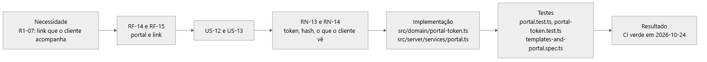

Oito cadeias completas, com implementação e teste: [03 Requisitos e rastreabilidade](docs/ciclo-de-vida/03-requisitos-e-rastreabilidade.md). Matriz completa: [rastreabilidade](docs/02-definicao/08-rastreabilidade.md).

## Arquitetura e decisões técnicas

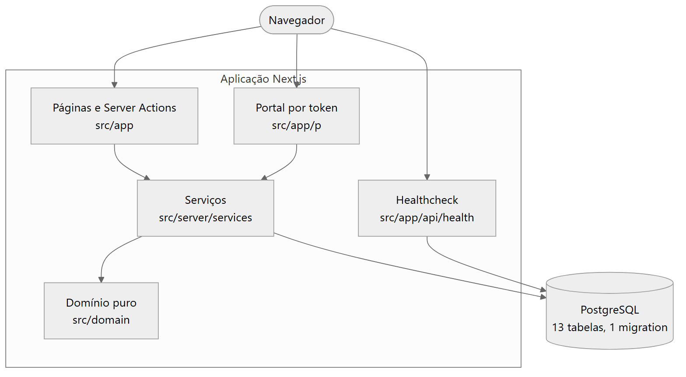

Três camadas: `src/app` (páginas e Server Actions finas), `src/server/services` (um caso de uso por função, com autorização, validação, transação e auditoria) e `src/domain` (regras puras, sem banco). Oito ADRs registram contexto, alternativas, custo aceito e quando mudar ([arquitetura](docs/03-arquitetura/README.md)). Diagramas de sequência, estados e contexto: [04 Arquitetura e decisões](docs/ciclo-de-vida/04-arquitetura-e-adrs.md).

### Decisão difícil

O teto de cerca de R$ 100/mês, na [reunião 1](docs/01-discovery/04-reuniao-1-kickoff-fundador.md) (simulada), tirou o WhatsApp automático do MVP e colocou o portal por link.

| Campo | Registro |
|---|---|
| Contexto | Custo recorrente máximo de cerca de R$ 100/mês, prazo de cerca de 3 meses e um desenvolvedor. O fundador queria mensagem automática no WhatsApp ao fim de cada etapa (R1-05, R1-06) |
| Alternativas | API oficial do WhatsApp Business, que cobra por conversa e exige aprovação de modelos de mensagem; ou uma página com o andamento, que o cliente acessa quando quiser. Para o portal: login, JWT no link, código curto com dado pessoal ou token opaco com hash ([ADR-007](docs/03-arquitetura/adr/007-portal-por-token.md)) |
| Escolha | WhatsApp automático fora do MVP; portal por link, com token de 32 bytes, só o SHA-256 no banco, validade padrão de 60 dias, somente leitura (R1-07) |
| Custo aceito | O cliente não recebe aviso automático, e quem tem o link acessa o conteúdo: é link secreto, não autenticação. O WhatsApp fica no [roadmap](docs/07-pos-go-live/roadmap.md) |
| Quando mudaria | Se o portal passasse a mostrar dados financeiros ou documentos, exigiria um segundo fator (código por e-mail) |

## Modelo de dados

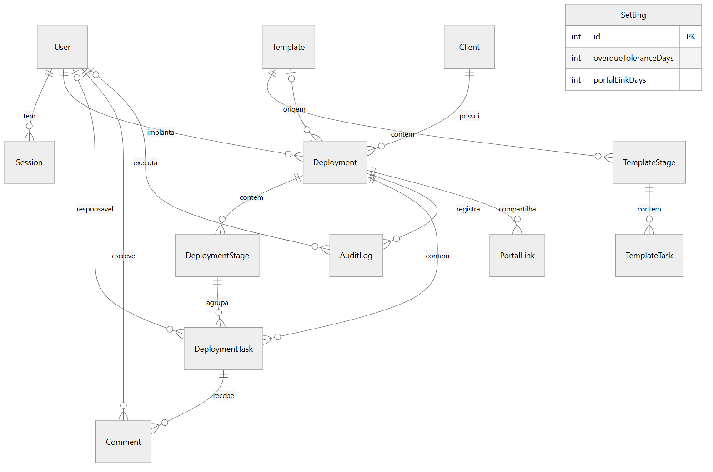

PostgreSQL com Prisma: 13 tabelas, 6 enums e uma migration (`20261022122435_init`). O prazo é `DATE` (dia civil); a situação "atrasada" não é gravada, é calculada na leitura; o token do portal e o da sessão são guardados só como hash; a auditoria só recebe inserções. Dicionário de dados, índices e integridade: [05 Modelo de dados](docs/ciclo-de-vida/05-modelo-de-dados.md).

### Fluxo principal do sistema

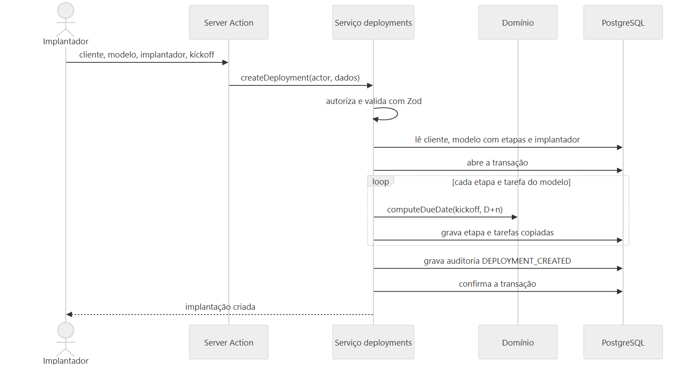

Do modelo à implantação, da tarefa ao painel e do painel ao portal: [fluxos principais](docs/ciclo-de-vida/04-arquitetura-e-adrs.md#fluxos-principais).

## Estratégia de testes e evidências

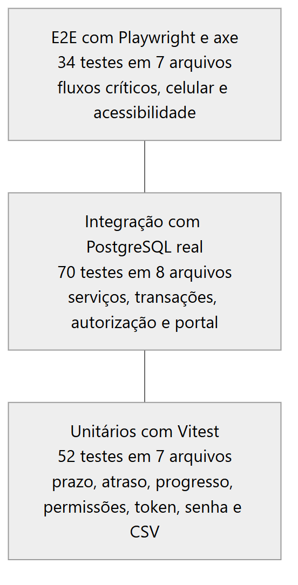

- 156 testes na CI em 2026-10-24: 52 unitários, 70 de integração e 34 E2E (6 de acessibilidade). Commit `a9066fe`, [run 40099053410](https://github.com/Joaogabrielmaia/Customer-onboarding-platform/actions/runs/40099053410), verde. [Registro](docs/05-qualidade/05-execucao-ci-2026-10-24.md).
- Seis defeitos (D1 a D6) com causa, correção e a verificação de cada um. A CI achou o D6 na primeira execução, em 2026-10-23, commit `453f1e1` ([run 39984884953](https://github.com/Joaogabrielmaia/Customer-onboarding-platform/actions/runs/39984884953)): o portal tinha 12 px de rolagem horizontal em 360 px, e a correção foi o commit `7de1de4`. Análise: [07 Testes e qualidade](docs/ciclo-de-vida/07-testes-e-qualidade.md#d6-a-falha-da-ci-de-2026-10-23).
- Registro local anterior: 156 testes em 2026-10-22, v1.1.0, commit `a16b9bf`, no [resultado da última execução](docs/05-qualidade/02-resultado-da-ultima-execucao.md).
- 8 ADRs e 32 linhas de rastreabilidade; 14 prints e a gravação do fluxo na [galeria](docs/imagens/README.md).

## Implantação, operação e adoção

| Item | Situação |
|---|---|
| Execução local e CI no GitHub | Existem e foram executadas |
| Deploy de aplicação em ambiente de uso | Não existe; a configuração de deploy foi criada e removida ([06](docs/ciclo-de-vida/06-desenvolvimento-e-configuracao.md#histórico-de-mudanças-relevantes)) |
| Rollout em cinco fases, plano de volta, treinamento e comunicação | Planos, não executados ([Episódio 6](docs/06-treinamento-e-rollout/README.md)) |
| Healthcheck e logs em JSON | Existem; sem alertas |
| Indicadores de adoção (I1 a I6) | Hipóteses, sem medição ([indicadores](docs/07-pos-go-live/indicadores.md)) |

Detalhes, incluindo migração dos dados, rollback e riscos operacionais: [08 Implantação e operação](docs/ciclo-de-vida/08-implantacao-e-operacao.md).

## Gestão de configuração e evolução

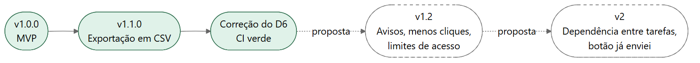

Commits seguem Conventional Commits, com o ID do requisito; as versões seguem o versionamento semântico, com tags anotadas e releases; os PRs 1 e 2 foram mesclados com a CI verde. O [workflow](.github/workflows/ci.yml) roda lint, tipos, testes e build a cada push na `main` e a cada pull request. Não há revisão humana de código registrada. Branches, ambientes, dependências e dívida técnica: [06](docs/ciclo-de-vida/06-desenvolvimento-e-configuracao.md). Versões, mudanças e roadmap: [09](docs/ciclo-de-vida/09-evolucao-e-roadmap.md).

## Competência → prova

| O que o projeto exercita | Onde está a prova |
|---|---|
| Levantar e priorizar problemas, com cliente e restrições (reuniões simuladas) | [Discovery](docs/ciclo-de-vida/01-visao-e-discovery.md) · [Problemas priorizados](docs/01-discovery/08-problemas-priorizados.md) |
| Transformar conversa em requisito, regra e teste (rastreabilidade) | [Requisitos](docs/ciclo-de-vida/03-requisitos-e-rastreabilidade.md) · [Matriz](docs/02-definicao/08-rastreabilidade.md) |
| Gerenciar o projeto com Scrum: backlog, releases e sprints | [Planejamento e Scrum](docs/ciclo-de-vida/02-planejamento-e-scrum.md) · [Sprints](docs/ciclo-de-vida/sprints/README.md) |
| Aceitar e recusar pedido de validação com justificativa (reunião simulada) | [Change-log](docs/04-prototipo/03-change-log.md) |
| Arquitetura, controle de acesso e auditoria | [Arquitetura e decisões](docs/ciclo-de-vida/04-arquitetura-e-adrs.md) · [ADR-005](docs/03-arquitetura/adr/005-auditoria.md) · [ADR-006](docs/03-arquitetura/adr/006-controle-de-acesso.md) |
| Modelagem de dados e SQL | [Modelo de dados](docs/ciclo-de-vida/05-modelo-de-dados.md) · [migration](prisma/migrations/20261022122435_init/migration.sql) |
| Testar, registrar defeitos e analisar causa raiz (D1 a D6) | [Testes e qualidade](docs/ciclo-de-vida/07-testes-e-qualidade.md) · [Execução na CI](docs/05-qualidade/05-execucao-ci-2026-10-24.md) |
| Planejar a entrada em uso, o plano de volta e o treinamento (plano, não executado) | [Implantação e operação](docs/ciclo-de-vida/08-implantacao-e-operacao.md) · [Rollout](docs/06-treinamento-e-rollout/README.md) |
| Gerência de configuração, versões e CI | [Desenvolvimento e configuração](docs/ciclo-de-vida/06-desenvolvimento-e-configuracao.md) · [ci.yml](.github/workflows/ci.yml) |
| Evolução e melhoria contínua | [Evolução e roadmap](docs/ciclo-de-vida/09-evolucao-e-roadmap.md) |

## Limites, riscos e evolução prevista

- Nenhum cliente real usou o sistema: a empresa, as pessoas e os dados são fictícios, e as reuniões são simuladas.
- A cobertura de código não foi medida.
- Firefox, Safari, celular físico, desempenho e acessibilidade manual não foram verificados; a CI roda só Chromium em Linux ([limitações](docs/05-qualidade/03-limitacoes-conhecidas.md)).
- Rollout, plano de volta e treinamento são planos, não executados; os indicadores são hipóteses, sem resultado medido.
- O portal não tem limite de requisições ([ADR-007](docs/03-arquitetura/adr/007-portal-por-token.md)) e a auditoria é imutável por convenção da aplicação, não por permissão do banco ([ADR-005](docs/03-arquitetura/adr/005-auditoria.md)).

Evolução prevista, sem datas ([roadmap](docs/07-pos-go-live/roadmap.md)):

- v1.2: alerta de atraso por e-mail, limite de acessos, testes de estado vazio e de atomicidade da auditoria.
- v2: dependência entre tarefas e confirmação "já enviei" no portal.

## Documentos complementares

- [Ciclo de vida: índice, linha do tempo e diagramas](docs/ciclo-de-vida/README.md) · [reuniões](docs/ciclo-de-vida/reunioes/README.md) · [sprints](docs/ciclo-de-vida/sprints/README.md) · [diagramas](docs/ciclo-de-vida/diagramas/README.md)
- [Guia da série em episódios](docs/INDEX.md) · [galeria de telas](docs/imagens/README.md) · [glossário](docs/GLOSSARIO.md)
- [CHANGELOG](CHANGELOG.md) · [CONTRIBUTING](CONTRIBUTING.md) · [runbook](docs/07-pos-go-live/runbook.md)

## Licença

[MIT](LICENSE). O código roda localmente; instruções no [CONTRIBUTING.md](CONTRIBUTING.md).

## Nota de contexto acadêmico

Este repositório é um estudo de caso. A Rota Fácil Software, as pessoas, os clientes e os dados são fictícios. Reuniões, atas, o cronograma das sprints e as cerimônias foram elaborados para compor o cenário de aprendizagem, com participantes identificados por papel; as datas dessas atividades pertencem ao cenário e não correspondem às datas de commits, releases ou execuções da CI, que seguem os registros do Git e do GitHub. Os dados de demonstração (seed) e os números do painel, como o tempo médio de 47 dias, são ilustrativos.

Houve uso de IA generativa (Claude, da Anthropic) na construção do cenário, incluindo a simulação das reuniões, e como apoio ao desenvolvimento e à documentação. O modelo do cenário, as decisões de escopo e de arquitetura e a verificação dos resultados foram definidos e conferidos pelo autor. Os resultados de testes e de CI citados vêm de execuções registradas e não são resultados ilustrativos.
