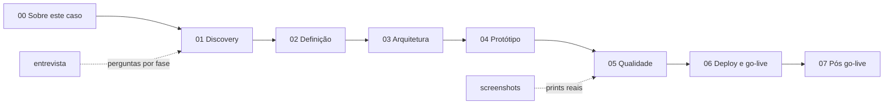

# Sobre este caso

**Objetivo:** deixar claro o que é real e o que é simulado neste repositório, e indicar a ordem de leitura.
**Data:** 2026-10-22 · **Status:** concluído (Fase 0)

> **Caso simulado de portfólio. Empresa, pessoas e dados são fictícios.**

## O que é real e o que é simulado

| Real (feito por mim) | Simulado (roteirizado por mim) |
|---|---|
| O código da plataforma Trilha | A empresa Rota Fácil Software |
| Requisitos, ADRs, modelo de dados e backlog | Fundador, líder de implantação, implantador, suporte e cliente |
| Testes e CI, e o resultado real de cada execução | As reuniões, entrevistas, o UAT e a retrospectiva |
| Decisões técnicas e seus trade-offs | Clientes, contratos e dados de demonstração (CPF/CNPJ claramente fictícios) |

Como o caso é simulado, **não existem resultados medidos de clientes**. Qualquer número de ganho (tempo economizado, menos atrasos) aparece só como hipótese ou meta, rotulado assim. O sistema fica publicado como **demonstração**, não como produto em produção com clientes.

Os bugs e as saídas de teste registrados nos documentos de qualidade são os que de fato aconteceram ao rodar o projeto.

## A empresa fictícia

A **Rota Fácil Software** é uma software house de cerca de 12 pessoas que vende um sistema de gestão para pequenas distribuidoras. Hoje conduz as implantações com planilhas, WhatsApp e e-mail. A Trilha é a plataforma que eu proponho para organizar esse processo. O detalhamento (carteira, equipe, dores e restrições) está em [`01-discovery`](../01-discovery/), na Fase 1.

## Ordem de leitura

| Pasta | O que encontrar | Status |
|---|---|---|
| [`01-discovery`](../01-discovery/) | Brainstorm, empresa, personas, reuniões 1 a 3, AS-IS, problemas | a fazer (Fase 1) |
| [`02-definicao`](../02-definicao/) | Visão, RF/RNF/RN, histórias, MoSCoW, backlog, rastreabilidade | a fazer (Fase 2) |
| [`03-arquitetura`](../03-arquitetura/) | ADRs, modelo de dados, segurança, custo | a fazer (Fase 3) |
| [`04-prototipo`](../04-prototipo/) | Wireframes, reunião 4, change-log | a fazer (Fase 4) |
| [`05-qualidade`](../05-qualidade/) | Estratégia de testes, resultado real, UAT | a fazer (Fase 6) |
| [`06-deploy-e-go-live`](../06-deploy-e-go-live/) | Deploy, rollout, treinamento, roteiro de vídeo | a fazer (Fases 7 e 8) |
| [`07-pos-go-live`](../07-pos-go-live/) | Runbook, indicadores, retrospectiva, roadmap | a fazer (Fase 9) |
| [`entrevista`](../entrevista/) | 3 perguntas e respostas por fase | a cada fase |
| [`vitrine`](../vitrine/) | Textos para currículo, LinkedIn e pitch | a fazer (Fase 10) |

## Convenções dos documentos

- Todo documento tem cabeçalho com objetivo, data e status, e links para os relacionados.
- Reuniões, entrevistas, atas e feedbacks começam com a etiqueta: `> Reunião simulada (roteirizada por mim para este caso de portfólio). Pessoas e empresa fictícias.`
- Decisões relevantes seguem o formato: contexto, alternativas, escolha, por quê, trade-off e quando eu mudaria de ideia.
- Requisitos, regras, histórias e testes têm IDs (RF-xx, RNF-xx, RN-xx) para rastreabilidade.

Instruções de trabalho do repositório: [`CLAUDE.md`](../../CLAUDE.md).
