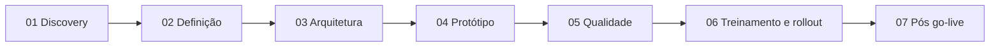

# Episódio 0 — Sobre o projeto

O cenário é a Rota Fácil Software, software house fictícia que conduz implantações com planilhas, WhatsApp e e-mail. Este episódio apresenta o cenário, a ordem de leitura das pastas e as convenções dos documentos.

| Documento | O que contém | Itens |
|---|---|---|
| [Sobre o projeto](#sobre-o-projeto) | Cenário, ordem de leitura e convenções | 7 pastas de fase |
| [Guia da série](../INDEX.md) | Episódios e trilhas de leitura de 2, 10 e 30 minutos | 8 episódios |
| [Glossário](../GLOSSARIO.md) | Termos e siglas do projeto | — |

← Início · [Índice](../INDEX.md) · [Episódio 1: Discovery](../01-discovery/README.md) →

---

# Sobre o projeto

**Objetivo:** explicar o cenário em que a Trilha foi desenhada e indicar a ordem de leitura.
**Data:** 2026-10-22 · **Status:** atualizado na v1.1.0

## O cenário

A Trilha foi pensada para a **Rota Fácil Software**, uma software house de cerca de 12 pessoas que vende um sistema de gestão para pequenas distribuidoras e conduz as implantações com planilhas, WhatsApp e e-mail. A empresa, as pessoas e os clientes são fictícios. As reuniões em `docs/` são simuladas e levam essa marcação. Números de ganho aparecem só como hipótese ou meta, nunca como resultado medido.

O que é verificável no repositório: o código, os requisitos e as regras, os ADRs, os testes e o resultado real de cada execução, e os defeitos encontrados pelo caminho.

## Ordem de leitura

| Pasta | O que encontrar |
|---|---|
| [`01-discovery`](../01-discovery/) | Brainstorm, empresa, personas, reuniões 1 a 3, AS-IS, problemas |
| [`02-definicao`](../02-definicao/) | Visão, RF/RNF/RN, histórias, MoSCoW, backlog, rastreabilidade |
| [`03-arquitetura`](../03-arquitetura/) | ADRs, modelo de dados, segurança |
| [`04-prototipo`](../04-prototipo/) | Wireframes, reunião 4, change-log |
| [`05-qualidade`](../05-qualidade/) | Estratégia de testes, resultado real, UAT, limitações |
| [`06-treinamento-e-rollout`](../06-treinamento-e-rollout/) | Rollout, treinamento, comunicação |
| [`07-pos-go-live`](../07-pos-go-live/) | Runbook, indicadores, retrospectiva, roadmap |
| [`imagens`](../imagens/) | Prints gerados com Playwright |

## Convenções

- Todo documento tem cabeçalho com objetivo, data e status, e links para os relacionados.
- Decisões relevantes seguem o formato: contexto, alternativas, escolha, por quê, trade-off e quando eu mudaria de ideia.
- Requisitos, regras e histórias têm IDs (RF, RNF, RN, US) para rastreabilidade.
