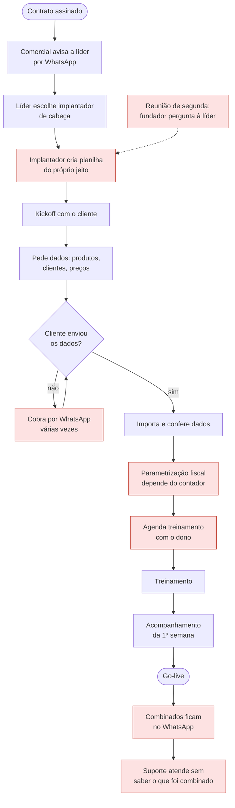

# Processo atual (AS-IS) da implantação

**Objetivo:** mostrar como a implantação funciona hoje na Rota Fácil e onde estão os gargalos.
**Data:** 2026-10-22 · **Status:** concluído
Relacionados: [Reunião 2](05-reuniao-2-lideranca-e-implantador.md) · [Problemas priorizados](08-problemas-priorizados.md)

> Processo montado a partir das reuniões simuladas. Cenário fictício.

## Gargalos marcados (em vermelho)

| ID | Onde | O que acontece | Evidência |
|---|---|---|---|
| G1 | Criação da planilha | Cada implantador monta a sua; etapas obrigatórias dependem de memória | R2-01, R2-02 |
| G2 | Espera pelos dados do cliente | Dados chegam atrasados e bagunçados; cobrança manual por WhatsApp | R2-03, R3-03 |
| G3 | Parametrização fiscal | Depende do contador do cliente, fora do controle da equipe | R2-04 |
| G4 | Agenda de treinamento | Depende da disponibilidade do dono do cliente | R2-03 |
| G5 | Combinados no WhatsApp | O que se combina não é registrado; o suporte não consegue consultar | R2-05, R3-01 |
| G6 | Acompanhamento semanal | O fundador só descobre atrasos na reunião de segunda ou quando o cliente liga | R1-01, R1-02 |
