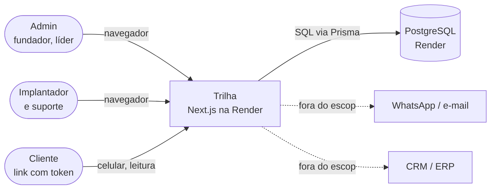
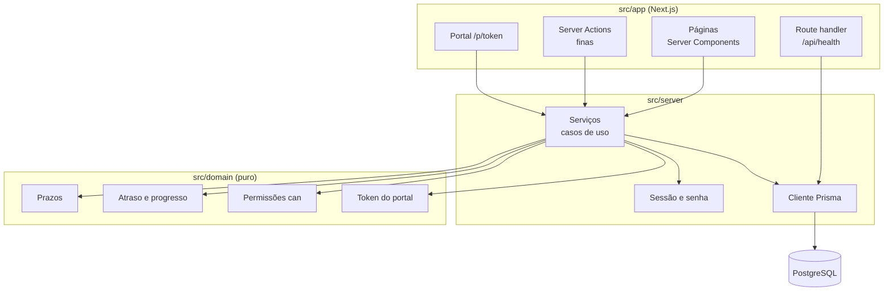
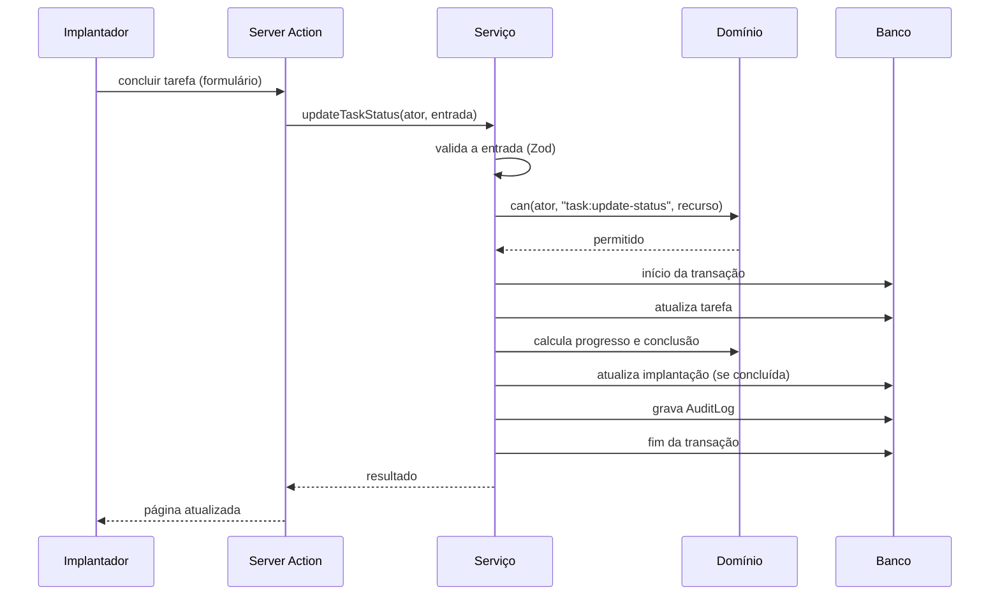

# Diagramas de contexto e de componentes

**Objetivo:** mostrar o sistema visto de fora e suas peças internas.
**Data:** 2026-10-22 · **Status:** concluído
Relacionados: [ADR-009](adr/009-camada-de-servicos.md) · [Modelo de dados](modelo-de-dados.md)

## Contexto

## Componentes

**Regra de dependência:** `domain` não importa nada de fora; `services` usa `domain` e o banco; `app` só chama `services`. Assim as regras são testadas sem Next e sem banco.

## Fluxo de uma alteração (exemplo: concluir tarefa)

