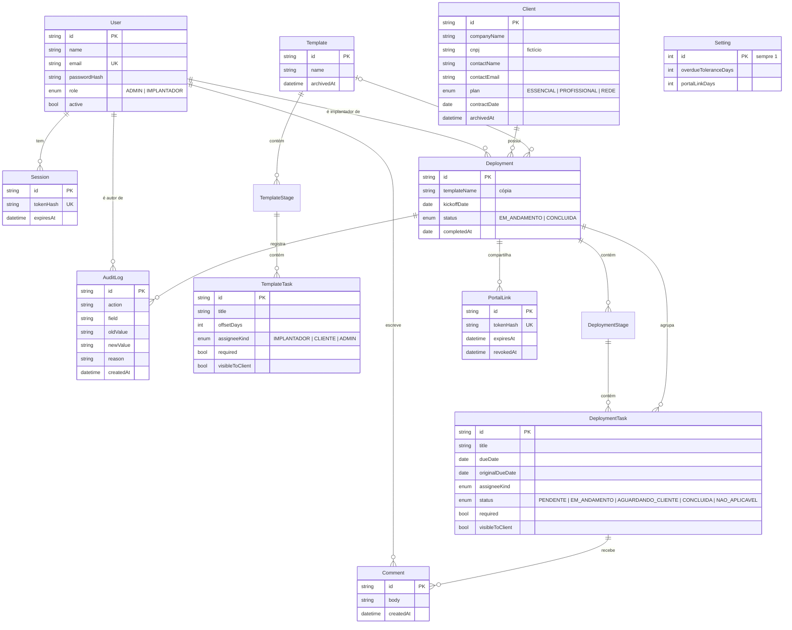

# Modelo de dados

**Objetivo:** apresentar o modelo relacional e explicar as escolhas.
**Data:** 2026-10-22 · **Status:** concluído (o schema Prisma implementa este desenho)
Relacionados: [ADR-003](adr/003-banco-e-orm.md) · [ADR-004](adr/004-tarefas-e-prazos-relativos.md) · [ADR-005](adr/005-auditoria.md) · [ADR-007](adr/007-portal-por-token.md)

## Escolhas e motivos

| Escolha | Motivo | Custo |
|---|---|---|
| Tabelas separadas para modelo (`Template*`) e implantação (`Deployment*`) | RN-10: a implantação é uma cópia; alterar o modelo não a afeta | Duplicação de dados |
| `dueDate` e `originalDueDate` como `DATE` | Prazo é dia civil; evita bug de fuso (RK-03). O original permite mostrar o quanto o prazo foi movido | Cálculo de "hoje" precisa usar a data local da empresa (America/Sao_Paulo) |
| `Deployment.templateName` copiado além da FK | Mantém o nome mesmo se o modelo for arquivado | Redundância pequena |
| `assigneeKind` + `assigneeId` opcional na tarefa | Tarefa do cliente não tem usuário interno (RN-09) | Duas colunas para um conceito |
| Atrasado **não** é uma coluna | RN-04: depende de "hoje" e da tolerância; guardar geraria dados velhos | Calculado em cada leitura (volume pequeno) |
| `AuditLog` ligado à implantação, com texto livre em valor anterior/novo | Histórico legível por pessoas, simples de consultar | Sem tipagem forte dos valores |
| `PortalLink` guarda só o hash | ADR-007 | Não é possível reexibir o link; precisa gerar outro |
| `Setting` com uma linha | Configuração global pequena (tolerância e validade do link) | Não escala para multiempresa (fora do escopo) |
| Arquivamento (`archivedAt`) em vez de exclusão | RN-16: preservar histórico | Listas precisam filtrar arquivados |
| Índices em `Deployment(status)`, `DeploymentTask(deploymentId)`, `DeploymentTask(assigneeId, status)` e `AuditLog(deploymentId, createdAt)` | Painel, fila de pendências e histórico são as consultas mais frequentes | Pequeno custo de escrita |

## O que não guardo
Senha em texto, token do cliente em texto, IP do cliente do portal, dados de pagamento, documentos pessoais. O CNPJ é opcional e, na demo, sempre fictício.
