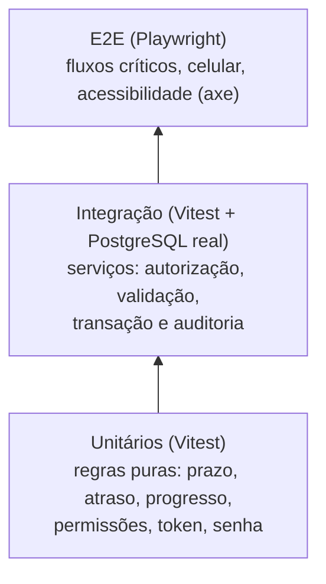

# Estratégia de testes

**Objetivo:** explicar o que testo, em que camada e por quê.
**Data:** 2026-10-22 · **Status:** concluído
Relacionados: [Resultado da última execução](02-resultado-da-ultima-execucao.md) · [Limitações](03-limitacoes-conhecidas.md) · [Rastreabilidade](../02-definicao/08-rastreabilidade.md) · [ADR-008](../03-arquitetura/adr/008-camada-de-servicos.md)

## Princípio

Testo cada coisa na camada mais barata que ainda a prova. Regra de negócio sutil vira teste unitário (rápido, sem banco). Comportamento que depende de banco, transação e permissão vira teste de integração. Só o que depende do navegador vira E2E.

## Camadas

| Camada | Ferramenta | O que cobre | Onde |
|---|---|---|---|
| Unitário | Vitest | `computeDueDate`, atraso, progresso, conclusão, tempo médio, fila, `can()`, token, hash de senha, datas civis | `tests/unit` |
| Integração dos serviços | Vitest + PostgreSQL 16 real | Login e sessão, usuários, clientes, modelos, criar implantação, status, prazo, comentários, auditoria, painel, regra de atraso, portal, seed | `tests/integration` |
| E2E | Playwright (Chromium) | Login e papéis, painel, clientes, criar implantação até o histórico, modelos, portal em 360 px, ausência de rolagem horizontal em 390 px, healthcheck | `tests/e2e` |
| Acessibilidade automática | axe-core via Playwright | Regras WCAG 2.x A/AA em 6 telas (falha se houver violação grave ou crítica) | `tests/e2e/accessibility.spec.ts` |
| Lint e tipos | ESLint (config do Next) e `tsc` em modo estrito | Erros de código e de tipo | CI |

## Decisões de teste (e o que perdi com elas)

1. **Integração contra PostgreSQL real, não contra mock.** Mocks do Prisma passariam mesmo se a transação estivesse errada. O preço é um pouco de lentidão (cerca de 30 s) e precisar de um banco. Mantenho o banco de testes separado (`trilha_test`) e o CI sobe um Postgres como serviço.
2. **"Integração da API" é integração dos serviços.** Segui o ADR-008: a API da aplicação são os serviços. Não testo endpoints REST porque não existem (só `/api/health`, coberto no E2E). Não chamo isso de teste de API REST.
3. **Relógio fixo nos testes de integração.** Os serviços recebem `now`, então o resultado não depende do dia em que o teste roda. Os E2E, ao contrário, usam o seed relativo a hoje, e os testes validam as categorias (atrasada, aguardando, no prazo), não datas absolutas.
4. **Axe não é teste de acessibilidade completo.** Pega contraste, rótulos e papéis ARIA, mas não avalia se a navegação por teclado faz sentido nem a experiência com leitor de tela. Isso ficou como verificação manual pendente (ver limitações).
5. **Só Chromium.** Cobrir Firefox e WebKit dobraria o tempo do E2E sem prova de benefício neste momento. Registrado como limitação.
6. **Não medi cobertura de código.** Preferi rastrear regra → teste (matriz) a perseguir um percentual. Por isso **não há número de cobertura** neste projeto, e não vou inventar um.

## Quando eu mudaria

Com usuários reais, adicionaria testes em Firefox e Safari, verificação manual com leitor de tela, e medição de cobertura com limite mínimo nas regras de negócio.
