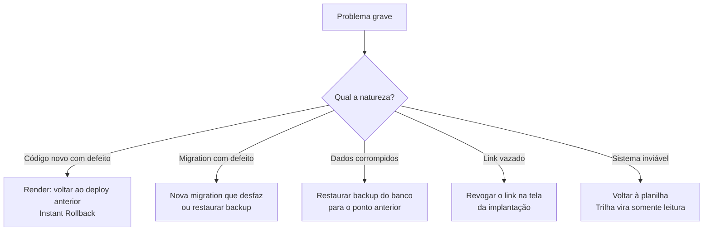

# Checklist de go-live e plano de rollback

**Objetivo:** garantir que nada essencial seja esquecido no go-live e que exista um caminho de volta.
**Data:** 2026-10-22 · **Status:** plano
Relacionados: [Plano de rollout](01-plano-de-rollout.md) · [Deploy](deploy.md) · [Runbook](../07-pos-go-live/)

## Checklist de go-live

### Técnico
- [ ] `/api/health` devolve `ok` (app e banco).
- [ ] Migrations aplicadas (`prisma migrate deploy` sem pendências).
- [ ] Variáveis de ambiente de produção conferidas (`DATABASE_URL`, `DIRECT_URL`, `AUTH_SECRET`, `APP_URL`).
- [ ] Senhas das contas criadas pelo seed trocadas (ou o seed nunca rodado no banco de produção).
- [ ] Execução mais recente do CI verde.
- [ ] Backup do banco confirmado (plano do provedor) e restauração testada uma vez.
- [ ] Contas de usuários reais criadas; contas do seed removidas ou desativadas.

### Dados
- [ ] Modelos revisados pela líder de implantação.
- [ ] Clientes do piloto cadastrados.
- [ ] Regra de atraso (tolerância) definida em *Configurações*.

### Pessoas
- [ ] Implantador-piloto treinado com o [guia](04-guia-treinamento-implantador.md).
- [ ] Líder sabe usar o painel e o filtro por implantador.
- [ ] Mensagem ao time e ao cliente-piloto enviadas ([comunicação](06-plano-de-comunicacao.md)).
- [ ] Combinado: onde pedir ajuda e quem responde.

### Cliente-piloto
- [ ] Link do cliente gerado e testado em um celular.
- [ ] Cliente avisado, com a mensagem pronta enviada por WhatsApp.

## Gatilhos de rollback

Volto atrás se ocorrer qualquer um:

1. Perda ou corrupção de dados de implantação.
2. Falha de autorização (alguém vê ou altera o que não deveria) ou vazamento de um link de cliente que não consigo conter revogando.
3. Sistema fora do ar por mais tempo do que a equipe consegue contornar.
4. A equipe não consegue trabalhar e o piloto está prejudicando a implantação do cliente.

## Plano de rollback

| Situação | Ação | Quem | Perda esperada |
|---|---|---|---|
| Deploy com bug | Na Render, fazer rollback para o deploy anterior (aba Events) | Quem fez o deploy | Nenhuma de dados |
| Migration com defeito | Aplicar migration corretiva; se destrutiva, restaurar backup | Responsável técnico | Possível perda desde o último backup |
| Dados corrompidos | Restaurar backup do provedor | Responsável técnico | Alterações desde o backup |
| Link de cliente vazado | Revogar o link; gerar outro | Implantador ou admin | Nenhuma |
| Sistema inviável | Retomar a planilha do cliente-piloto; Trilha fica só para consulta; comunicar o time | Líder | Registros feitos só na Trilha precisam ser copiados à mão |

**Por que o rollback é barato no piloto:** durante o piloto a planilha continua sendo preenchida em paralelo, então voltar atrás não perde o controle do cliente.

## Depois de um rollback

Registro o que aconteceu, a causa e o que muda antes de tentar de novo, no runbook. Sem culpar pessoas.
