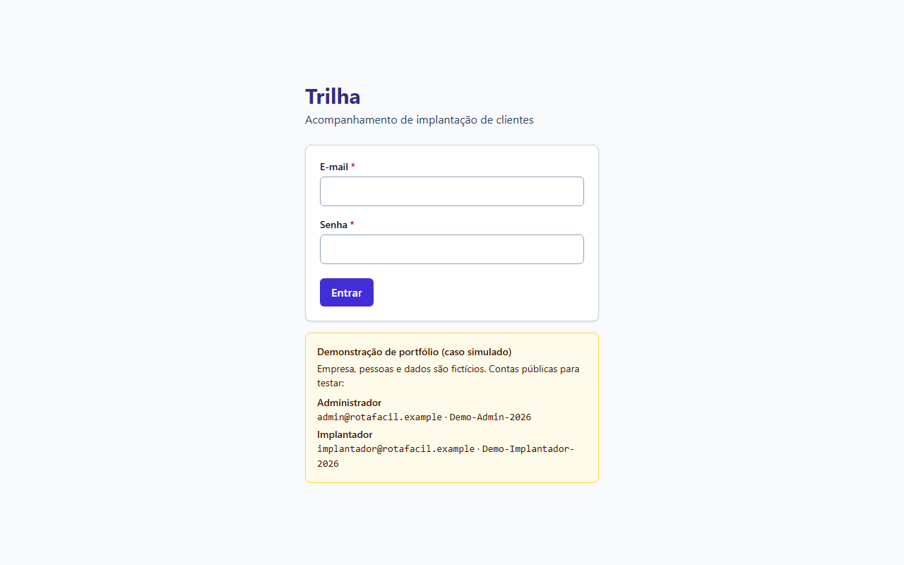
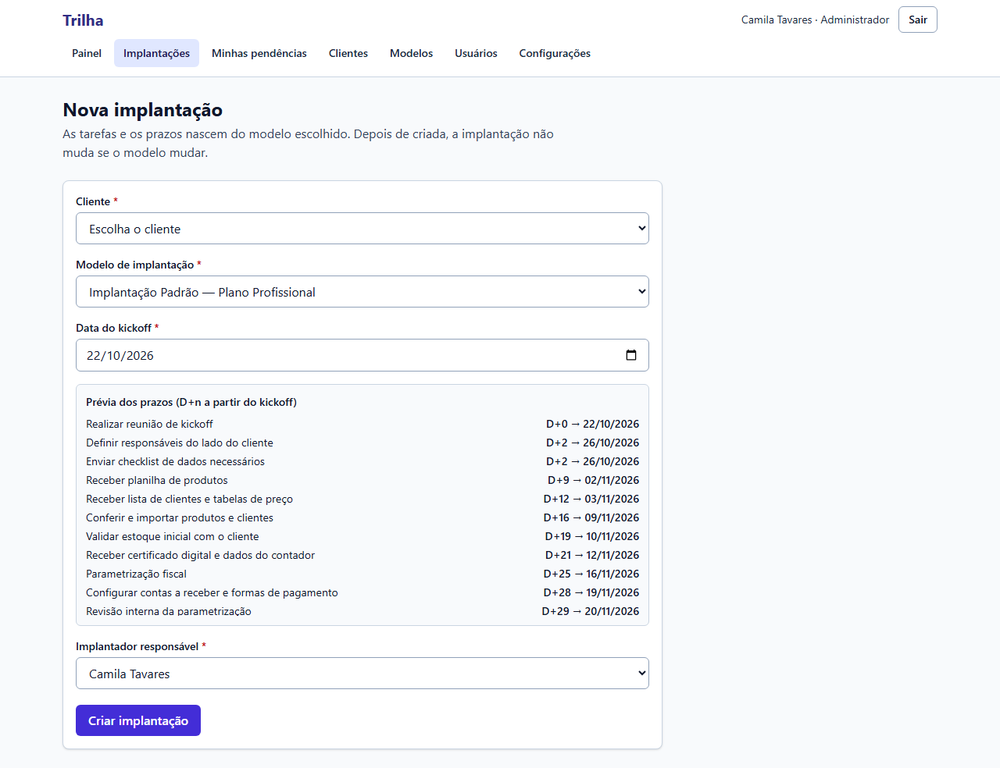
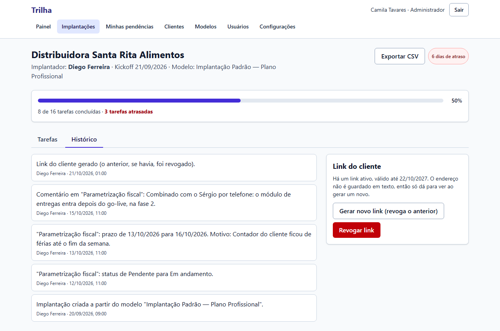
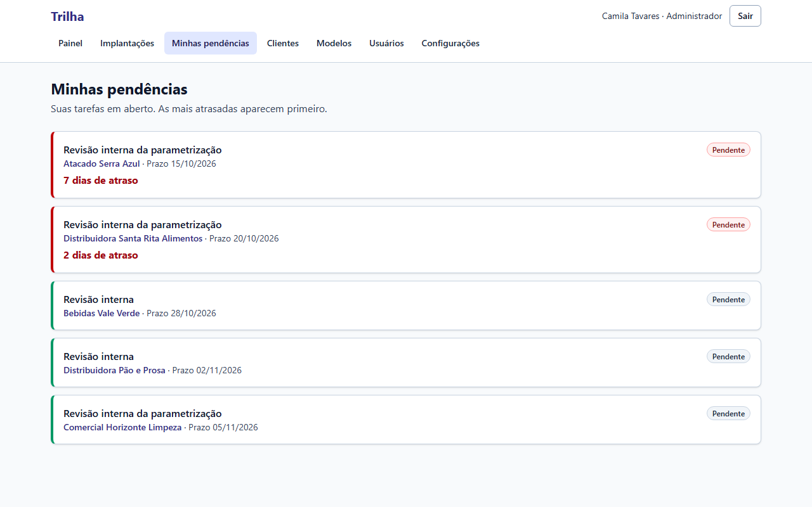

# Guia de treinamento: implantador

**Objetivo:** ensinar o implantador a conduzir uma implantação na Trilha, do cadastro ao go-live.
**Data:** 2026-10-22 · **Status:** concluído (prints reais, com dados de demonstração)
Relacionados: [Guia rápido do cliente](05-guia-rapido-cliente.md) · [Plano de rollout](01-plano-de-rollout.md)

> Empresa, pessoas e dados dos prints são fictícios (caso simulado). Duração sugerida do treinamento: cerca de 45 minutos, com a pessoa mexendo no sistema.

## O que muda no seu dia

Antes: planilha pessoal, WhatsApp e memória. Agora: **um lugar só**, com as mesmas etapas para todos, prazos calculados e histórico. A regra de ouro: **se você combinou algo com o cliente, escreva como comentário na tarefa.**

## 1. Entrar

Acesse o endereço da Trilha, informe e-mail e senha. Use a senha que o administrador passou; ele pode redefini-la se você esquecer.

## 2. Ler o painel

O **Painel** mostra quatro números e uma lista **"Atenção primeiro"**.

- **Atrasadas (equipe):** tem tarefa sua ou do time vencida. Os dias de atraso aparecem em vermelho.
- **Aguardando cliente:** a tarefa vencida depende do cliente. **Não é atraso seu**, mas fica visível.
- Use o filtro **Implantador** para ver só o que é seu.

## 3. Cadastrar o cliente e iniciar a implantação

1. **Clientes → Novo cliente**: empresa, contato, plano e data do contrato.
2. No cliente, **Iniciar implantação** (ou **Nova implantação**).
3. Escolha o **modelo** e a **data do kickoff**. A prévia mostra os prazos reais: os que cairiam no fim de semana vão para segunda.
4. **Criar implantação.** As tarefas já nascem com responsável e prazo.

## 4. Conduzir as tarefas

Na tela da implantação, cada tarefa tem prazo, responsável e status.

| Status | Quando usar |
|---|---|
| Pendente | Ainda não começou |
| Em andamento | Você está trabalhando nisso |
| **Aguardando cliente** | Você depende de algo do cliente (arquivo, dado, agenda) |
| Concluída | Terminou |
| Não aplicável | Só para tarefas **opcionais** que não valem para este cliente |

- **Mudar o status:** use a lista ao lado da tarefa; salva ao escolher.
- **Ajustar prazo:** abra *Detalhes e comentários* → novo prazo → **motivo obrigatório**. O prazo original continua visível.
- **Comentar:** registre o que foi combinado. Comentários são **internos**; o cliente nunca os vê.
- Você só altera as implantações em que é o responsável. Nas demais, consulta e comenta.

## 5. Consultar o histórico

A aba **Histórico** mostra quem mudou o quê e quando, com o motivo. Serve para tirar dúvidas ("quando esse prazo mudou e por quê?").

## 6. Minhas pendências

Sua fila de tarefas em aberto, **as mais atrasadas primeiro**. Abra no começo do dia.

## 7. Compartilhar o link com o cliente

1. Na implantação, **Gerar link do cliente**.
2. **Copie agora:** o endereço aparece uma única vez, junto com uma **mensagem pronta** para colar no WhatsApp.
3. Se o link vazar ou o cliente trocar de contato, **Revogar** (ou gerar um novo, que revoga o anterior).

O cliente vê o andamento e o que depende dele. Não vê comentários nem tarefas internas. Veja o [guia rápido do cliente](05-guia-rapido-cliente.md).

## 8. Dúvidas comuns

| Pergunta | Resposta |
|---|---|
| "Não consigo mudar o status de uma tarefa" | Você não é o responsável por essa implantação nem pela tarefa. Peça à líder ou ao responsável |
| "Salvei o prazo e deu erro" | Falta o motivo, ou o prazo é igual ao atual |
| "Marquei 'não aplicável' e recusou" | A tarefa é **obrigatória** |
| "O cliente diz que não abre o link" | Pode ter sido revogado ou expirado. Gere um novo |
| "Preciso de uma etapa nova no modelo" | Peça à líder (só administradores editam modelos). Vale para as próximas implantações, não para as em andamento |

## Exercício final (10 minutos)

1. Crie um cliente de teste e uma implantação a partir de um modelo.
2. Conclua a primeira tarefa e coloque uma em *Aguardando cliente*.
3. Ajuste um prazo com motivo e escreva um comentário.
4. Abra o histórico e confira os registros.
5. Gere o link, abra em uma janela anônima e depois revogue.
