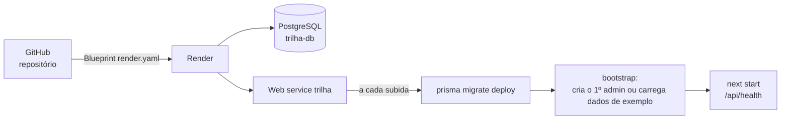

# Deploy na Render

**Objetivo:** passo a passo para publicar a Trilha na Render, do zero.
**Data:** 2026-10-22 · **Status:** pronto para publicar (a publicação depende da minha conta; ver [ações manuais](acoes-manuais.md))
Relacionados: [ADR-008](../03-arquitetura/adr/008-hospedagem.md) · [Custo](../03-arquitetura/custo-hospedagem.md) · [Runbook](../07-pos-go-live/runbook.md)

## O que o `render.yaml` já faz

- Cria o banco PostgreSQL `trilha-db` e o serviço web `trilha`.
- Liga o serviço ao banco (`DATABASE_URL`) e gera o `AUTH_SECRET`.
- Build: `npm ci --include=dev && npm run build`.
- A cada subida (`npm run start:render`): aplica as migrations, roda o bootstrap e inicia o app. O healthcheck é `/api/health`.
- **Bootstrap:** só age quando o banco não tem nenhum usuário. Cria o primeiro administrador (ou carrega os dados de exemplo) e nunca apaga nada em reinícios. Isso existe porque o plano gratuito da Render não tem terminal.

## Passo a passo

1. **Envie o código ao GitHub** (ver [ações manuais](acoes-manuais.md)).
2. Na Render: **New → Blueprint**, escolha o repositório e confirme. A Render lê o `render.yaml`.
3. Ela pede dois valores marcados como segredo:

| Variável | O que colocar |
|---|---|
| `BOOTSTRAP_ADMIN_EMAIL` | o e-mail do primeiro administrador |
| `BOOTSTRAP_ADMIN_PASSWORD` | uma senha forte, com 10 ou mais caracteres |

4. **Apply.** Aguarde o primeiro build (alguns minutos).
5. Abra `https://<seu-serviço>.onrender.com/api/health`. Esperado: `{"status":"ok","database":"ok",...}`.
6. Abra a página inicial e entre com o e-mail e a senha que você definiu.

### Com dados de exemplo ou sem?

O `render.yaml` define `SEED_EXAMPLE_DATA=true`: no primeiro start, com o banco vazio, o app carrega 8 clientes, 3 modelos e 7 implantações, e **todos os usuários do seed usam a senha de `BOOTSTRAP_ADMIN_PASSWORD`**. Os e-mails ficam em `src/server/seed-data.ts` (por exemplo `admin@rotafacil.example`, e não o e-mail que você digitou).

Para publicar **sem** dados de exemplo, mude `SEED_EXAMPLE_DATA` para `"false"` no painel da Render antes do primeiro start: o app cria só o administrador com o e-mail e a senha informados.

## Variáveis de ambiente

| Variável | Origem | Uso |
|---|---|---|
| `DATABASE_URL` | Automática (banco da Render) | Conexão do app |
| `AUTH_SECRET` | Gerada pela Render | Reservada para assinar valores sensíveis |
| `NODE_VERSION` | `render.yaml` (24) | Versão do Node |
| `BOOTSTRAP_ADMIN_EMAIL` / `BOOTSTRAP_ADMIN_PASSWORD` | Você informa | Primeiro acesso |
| `SEED_EXAMPLE_DATA` | `render.yaml` | `true` carrega dados de exemplo no primeiro start |
| `APP_URL` | Opcional | Base do link do cliente. Se vazia, usa o endereço público da Render (`RENDER_EXTERNAL_URL`) |

## Limitações do plano gratuito (confira o plano vigente na Render)

- O serviço web **dorme depois de um tempo sem acesso**; a primeira visita seguinte demora (cerca de um minuto).
- O banco PostgreSQL gratuito tem **prazo de validade**: depois de algumas semanas ele expira e precisa ser recriado ou migrado para um plano pago. Quando recriar, o bootstrap reconstrói tudo no primeiro start. Se for manter o ambiente, use um plano pago do banco.
- Sem terminal no plano gratuito: por isso o bootstrap.

## Depois de publicar

- **Recarregar dados de exemplo:** o seed apaga tudo. Com o banco da Render acessível de fora, rode no seu computador: `DATABASE_URL="<url externa do banco>" SEED_CONFIRM_RESET=yes npm run db:seed`. O comando recusa rodar em banco que não seja local sem essa confirmação.
- **Esqueci a senha do administrador:** com a URL externa do banco, `DATABASE_URL="<url externa>" npm run admin:reset-password -- <email> <nova-senha>`.
- **Reverter um deploy:** na Render, abra o serviço, aba *Events*, e faça o *rollback* para o deploy anterior.
- Mais detalhes no [runbook](../07-pos-go-live/runbook.md).
