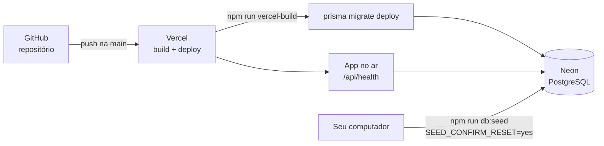

# Deploy (Vercel + Neon)

**Objetivo:** passo a passo para publicar a Trilha, do zero.
**Data:** 2026-10-22 · **Status:** guia pronto; a publicação depende das minhas contas (ver [ações manuais](acoes-manuais.md)).
Relacionados: [ADR-008](../03-arquitetura/adr/008-hospedagem.md) · [Custo](../03-arquitetura/custo-hospedagem.md) · [Runbook](../07-pos-go-live/)



## Pré-requisitos

- Repositório no GitHub com o código (ver [ações manuais](acoes-manuais.md)).
- Conta gratuita na Vercel e na Neon.

## 1. Criar o banco na Neon

1. Crie um projeto (nome sugerido: `trilha`) e escolha a região mais próxima do app. A Vercel está configurada em `gru1` (São Paulo); na Neon, escolha **AWS São Paulo** se disponível.
2. Em **Connection details**, copie duas connection strings:
   - **com pooler** (host com `-pooler`): será a `DATABASE_URL`;
   - **sem pooler** (conexão direta): será a `DIRECT_URL`, usada só pelas migrations.
3. Ambas devem terminar com `sslmode=require`.

## 2. Criar o projeto na Vercel

1. **Add New → Project** e importe o repositório. O framework (Next.js) é detectado; o `vercel.json` já define o comando de build (`npm run vercel-build`) e a região.
2. Antes de implantar, em **Environment Variables**, cadastre (para Production):

| Variável | Valor | Observação |
|---|---|---|
| `DATABASE_URL` | string **com pooler** da Neon | Obrigatória |
| `DIRECT_URL` | string **sem pooler** da Neon | Obrigatória para as migrations |
| `AUTH_SECRET` | resultado de `openssl rand -base64 32` | Reservada; defina um valor próprio |
| `APP_URL` | `https://<seu-projeto>.vercel.app` | Usada para montar o link do cliente. Se ficar vazia, uso o domínio de produção da Vercel |

3. **Deploy.** O build roda `prisma migrate deploy` (cria as tabelas), `prisma generate` e `next build`.

## 3. Carregar os dados de exemplo

O seed é um passo manual, porque **apaga tudo** do banco. Do seu computador, na pasta do projeto:

```bash
# Windows (PowerShell)
$env:DATABASE_URL = "<string COM pooler ou direta da Neon>"
$env:SEED_CONFIRM_RESET = "yes"
npm run db:seed
```

```bash
# macOS / Linux
DATABASE_URL="<string da Neon>" SEED_CONFIRM_RESET=yes npm run db:seed
```

O comando recusa rodar em banco que não seja local sem `SEED_CONFIRM_RESET=yes`, para evitar apagar um banco por engano. A saída lista as implantações criadas (no prazo, atrasadas, aguardando cliente e concluídas).

> As datas do seed são relativas ao dia em que ele roda: se o ambiente ficar parado por dias, rode de novo (ou use o workflow agendado abaixo), senão as tarefas vão envelhecendo e tudo aparece atrasado.

## 4. Verificar

1. Abra `https://<seu-projeto>.vercel.app/api/health`. Esperado: `{"status":"ok","database":"ok",...}`.
2. Abra a página inicial e entre com uma das contas do seed (ver `src/server/seed-data.ts`).
3. Gere um link de cliente em uma implantação e confirme que abre sem login.
4. Se a primeira visita demorar alguns segundos, é o banco gratuito acordando (limitação conhecida).

## Opcional: recarregar os dados de exemplo toda semana

O workflow `.github/workflows/reseed.yml` recria os dados toda segunda-feira. Ele **só roda se** você criar o segredo `SEED_DATABASE_URL` em *Settings → Secrets and variables → Actions* com a string do banco de demonstração. Sem o segredo, ele não faz nada. Também pode ser disparado à mão na aba *Actions*.

## Migrations: como reverter

Ver o [runbook](../07-pos-go-live/runbook.md). Resumo: o Prisma não faz rollback automático; reverter é escrever uma nova migration que desfaz a anterior e aplicá-la.

## O que este guia não cobre

Domínio próprio, backup automático, monitoramento externo e plano pago. Ficam para depois; estão no [roadmap](../07-pos-go-live/).
