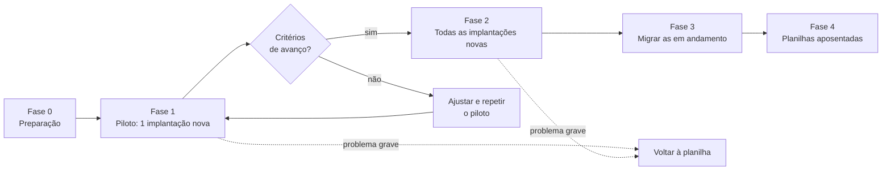

# Plano de rollout

**Objetivo:** descrever como a Rota Fácil passaria a usar a Trilha, em etapas e com critério para avançar.
**Data:** 2026-10-22 · **Status:** plano (ainda não executado)
Relacionados: [Checklist de entrada em uso](02-checklist-de-entrada-em-uso.md) · [Comunicação](06-plano-de-comunicacao.md) · [Treinamento](04-guia-treinamento-implantador.md) · [Riscos](../02-definicao/07-riscos.md)

> Os critérios de avanço abaixo são **metas/hipóteses** que eu usaria num piloto real. Não há resultado medido.

## Estratégia: piloto pequeno, depois ampliar

O risco principal (RK-08) é a equipe não preencher o sistema. Por isso começo com **uma implantação nova**, conduzida por **um implantador**, com a líder acompanhando de perto. Se o piloto não funcionar, o custo de voltar atrás é pequeno.

## Fases

| Fase | O que acontece | Quem | Duração sugerida |
|---|---|---|---|
| 0. Preparação | App e banco funcionando, contas criadas, modelos revisados pela líder, treinamento do implantador-piloto | Eu, líder | Alguns dias |
| 1. Piloto | **Uma** implantação nova (cliente-piloto fictício: *Costa Lima Embalagens e Distribuição*, plano Rede) usa a Trilha do kickoff ao go-live. A planilha antiga **continua sendo preenchida em paralelo** só neste cliente | Implantador-piloto (Diego), líder | Uma implantação inteira |
| 2. Ampliação | Toda implantação **nova** nasce na Trilha. Os dois implantadores usam | Equipe de implantação | Enquanto houver implantações novas |
| 3. Migração | As implantações em andamento são recriadas na Trilha (com o kickoff original) | Líder | Poucos dias |
| 4. Encerramento das planilhas | Planilhas viram somente leitura e depois são arquivadas | Líder | Depois da fase 3 estável |

## Critérios para avançar (metas, não resultados)

| De → Para | Critério |
|---|---|
| Piloto → Ampliação | O implantador-piloto atualizou as tarefas durante o piloto sem precisar de ajuda constante; o cliente-piloto abriu o link do portal; a líder consegue ver o atraso no painel sem perguntar ao implantador; nenhum problema grave de dados |
| Ampliação → Migração | Duas ou mais implantações novas rodando sem abandono do preenchimento; ajustes do modelo feitos |
| Migração → Encerramento | Todas as implantações em andamento na Trilha; a reunião de segunda usa o painel |

## O que eu observaria no piloto

O que a equipe **faz** (preenche ou volta ao WhatsApp?), mais do que o que **diz**. Lista de perguntas para a [retrospectiva simulada](../07-pos-go-live/reuniao-6-retrospectiva.md): o que travou, o que sobrou de campo, o que faltou, o cliente abriu o link?

## Riscos do rollout

| Risco | Mitigação |
|---|---|
| Duplo trabalho (planilha e Trilha) desanima | Duplo trabalho só no cliente-piloto; depois a planilha deixa de ser a fonte |
| Cliente ignora o link | Mensagem pronta para enviar por WhatsApp; o implantador avisa que o link existe |
| Modelo não representa a realidade | A líder revisa o modelo antes do piloto; ajustes entram no modelo, não nas implantações em andamento |
