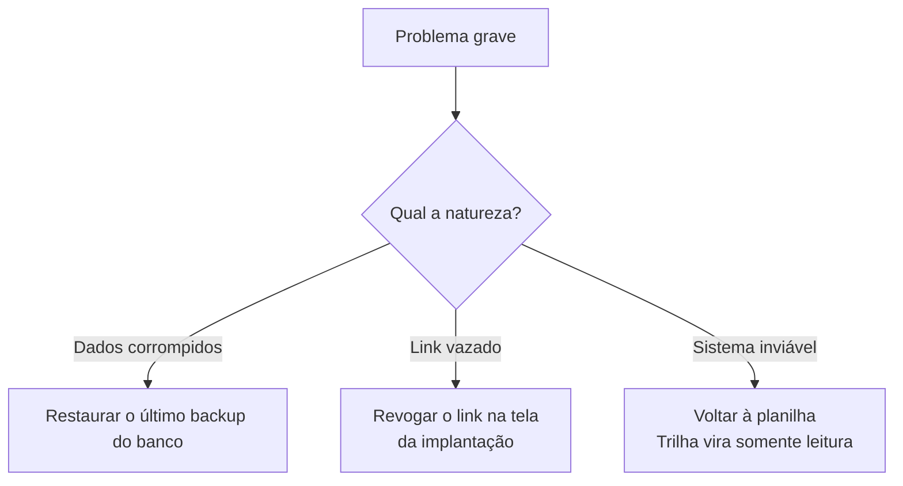

# Checklist de entrada em uso e plano de volta

**Objetivo:** garantir que nada essencial seja esquecido quando a equipe começar a usar a Trilha e que exista um caminho de volta para a planilha.
**Data:** 2026-10-22 · **Status:** plano (não executado; a Trilha roda só localmente)
Relacionados: [Plano de rollout](01-plano-de-rollout.md) · [Comunicação](06-plano-de-comunicacao.md) · [Runbook](../07-pos-go-live/runbook.md)

## Checklist

### Antes do piloto
- [ ] `/api/health` devolve `ok` (app e banco).
- [ ] Execução mais recente do CI verde.
- [ ] Senhas das contas do seed trocadas, ou contas reais criadas e as do seed desativadas.
- [ ] Combinado quem faz backup do banco e como ([runbook](../07-pos-go-live/runbook.md)).

### Dados
- [ ] Modelos revisados pela líder de implantação.
- [ ] Clientes do piloto cadastrados.
- [ ] Regra de atraso (tolerância) definida em *Configurações*.

### Pessoas
- [ ] Implantador-piloto treinado com o [guia](04-guia-treinamento-implantador.md).
- [ ] Líder sabe usar o painel e o filtro por implantador.
- [ ] Mensagem ao time e ao cliente-piloto enviadas ([comunicação](06-plano-de-comunicacao.md)).
- [ ] Combinado: onde pedir ajuda e quem responde.

### Cliente-piloto
- [ ] Link do cliente gerado e testado em um celular.
- [ ] Cliente avisado, com a mensagem pronta enviada por WhatsApp.

## Gatilhos para voltar à planilha

Volto atrás se ocorrer qualquer um:

1. Perda ou corrupção de dados de implantação.
2. Falha de autorização (alguém vê ou altera o que não deveria) ou vazamento de um link de cliente que não consigo conter revogando.
3. Sistema fora do ar por mais tempo do que a equipe consegue contornar.
4. A equipe não consegue trabalhar e o piloto está prejudicando a implantação do cliente.

## Plano de volta

| Situação | Ação | Quem | Perda esperada |
|---|---|---|---|
| Dados corrompidos | Restaurar o backup do banco ([runbook](../07-pos-go-live/runbook.md)) | Responsável técnico | Alterações desde o backup |
| Link de cliente vazado | Revogar o link; gerar outro | Implantador ou admin | Nenhuma |
| Sistema inviável | Retomar a planilha do cliente-piloto; Trilha fica só para consulta; comunicar o time | Líder | Registros feitos só na Trilha precisam ser copiados à mão |

**Por que voltar é barato no piloto:** durante o piloto a planilha continua sendo preenchida em paralelo, então voltar atrás não perde o controle do cliente.

## Depois de voltar atrás

Registro o que aconteceu, a causa e o que muda antes de tentar de novo, no runbook. Sem culpar pessoas.
