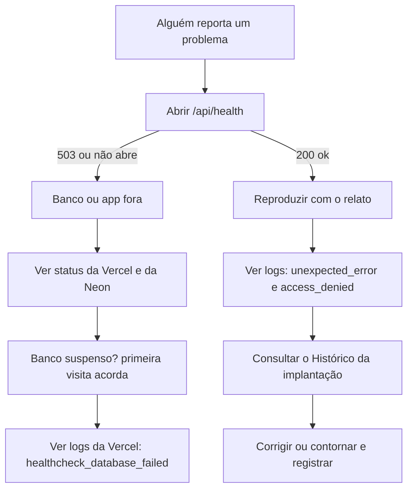

# Runbook de operação

**Objetivo:** dizer como investigar problemas, fazer backup, reverter e quem faz o quê.
**Data:** 2026-10-22 · **Status:** concluído (escrito para a demonstração; adaptar se houvesse uso real)
Relacionados: [Deploy](../06-deploy-e-go-live/deploy.md) · [Rollback](../06-deploy-e-go-live/02-checklist-go-live-e-rollback.md) · [Limitações](../05-qualidade/03-limitacoes-conhecidas.md)

> Este runbook usa só o que o projeto tem hoje (healthcheck, logs em JSON, Prisma, Vercel e Neon). Onde dependo de recursos do provedor, digo para **conferir o plano vigente**, porque limites e preços mudam.

## 1. Quem faz o quê

| Papel | Pessoa (cenário) | Responsabilidade |
|---|---|---|
| Responsável técnico | Desenvolvedor da Trilha | Deploy, banco, migrations, backup, correção de defeitos |
| Dona do processo | Líder de implantação | Modelos, regra de atraso, usuários, priorizar pedidos |
| Usuários | Implantadores e suporte | Reportar problema com o que estavam fazendo |
| Decisor | Fundador | Aprovar mudanças de escopo e custo |

## 2. Primeiros passos diante de um problema



1. **Healthcheck:** `GET /api/health` devolve `{"status":"ok","database":"ok"}` (200) ou `degraded` (503). Se der 503, o app está no ar mas o banco não responde.
2. **Logs:** a Vercel mostra os logs de execução. Cada linha é um JSON com `event`. Os principais: `login_failed`, `login_ok`, `access_denied`, `unexpected_error` e `healthcheck_database_failed`. Os logs **não têm senha, token nem e-mail**.
3. **Histórico da implantação:** a aba *Histórico* mostra quem mudou prazo, status ou responsável, útil para "quem mexeu nisso?".
4. **Reproduzir** com a conta e a implantação do relato (ver permissões: só o responsável altera).

## 3. Problemas comuns

| Sintoma | Causa provável | O que fazer |
|---|---|---|
| Primeira página demora muito | Banco gratuito acordando | Esperar alguns segundos; se repetir, ver o plano do provedor |
| "Algo deu errado" em várias telas | Banco fora ou migration pendente | `/api/health`; conferir se o último deploy aplicou as migrations |
| Usuário não consegue entrar | Senha errada, usuário desativado ou sessão expirada | Admin confere em *Usuários* e redefine a senha |
| O único admin perdeu o acesso | — | Ver "Redefinir senha pelo terminal" abaixo |
| Cliente diz que o link não abre | Link expirado, revogado ou digitado errado | Gerar novo link na implantação |
| Tudo aparece atrasado na demo | O seed envelheceu | Rodar o seed de novo |
| Implantador não altera uma tarefa | Não é o responsável | Pedir ao responsável ou à líder (regra RN-12) |

### Redefinir senha pelo terminal

Quando ninguém com papel de administrador consegue entrar:

```bash
# com DATABASE_URL apontando para o banco certo
npm run admin:reset-password -- <email> <nova-senha-com-10-ou-mais-caracteres>
```

O comando redefine a senha, reativa o usuário se estiver desativado e encerra as sessões dele. Troque a senha pela interface depois.

## 4. Backup e restauração

- **O que preciso proteger:** o banco PostgreSQL. O código está no Git.
- **Como:** o backup é uma função do provedor do banco. **Confira no plano vigente da Neon** o que está incluído (retenção, restauração para um ponto no tempo). No plano gratuito a janela é limitada; para uso real eu contrataria um plano com retenção adequada.
- **Cópia manual adicional:** `pg_dump` com a string direta (`DIRECT_URL`), por exemplo antes de uma migration arriscada:

```bash
pg_dump "$DIRECT_URL" --format=custom --file=trilha-$(date +%F).dump
```

- **Restaurar:** criar um banco novo e usar `pg_restore`, ou usar o recurso de restauração do provedor. **Teste a restauração ao menos uma vez** antes de depender dela.
- **Dados de demonstração** não precisam de backup: o seed os recria.

## 5. Reverter uma migration

O Prisma **não** tem rollback automático. Caminhos, do mais seguro ao mais drástico:

1. **Migration ainda não aplicada em produção:** apagar a pasta da migration e recriar (`prisma migrate dev`).
2. **Já aplicada e sem dados em risco:** escrever uma **nova migration que desfaz** a anterior (`prisma migrate dev --name desfaz_...`) e fazer o deploy.
3. **Já aplicada e destrutiva** (apagou coluna ou tabela): restaurar o backup anterior à migration e reaplicar o deploy anterior do código.
4. **Migration que falhou no meio:** `prisma migrate resolve --rolled-back <nome>` marca como revertida depois de corrigir o banco à mão. Só com cuidado.

**Regra:** toda migration que remove ou altera tipo de coluna exige backup antes e deploy em duas etapas (primeiro o código que não usa mais a coluna, depois a migration).

## 6. Rotina

| Quando | Tarefa |
|---|---|
| A cada deploy | Conferir `/api/health` e entrar com um usuário |
| Toda semana (demo) | Rodar o seed ou deixar o workflow agendado fazer |
| A cada mês | Revisar usuários ativos; remover contas que saíram |
| A cada trimestre | Rodar `npm audit` e atualizar dependências com os testes verdes |
| Depois de qualquer incidente | Registrar o que houve, a causa e a mudança, sem culpar pessoas |

## 7. Severidade e prazo de resposta (propostos)

| Nível | Exemplo | Resposta desejada |
|---|---|---|
| Alta | Sistema fora do ar; usuário vê dado que não deveria | Imediata; considerar rollback |
| Média | Uma tela com erro; link de cliente não abre | No mesmo dia útil |
| Baixa | Texto errado; melhoria | Entra no backlog |

Os prazos são **propostas**; numa demonstração gratuita não há compromisso (SLA).
