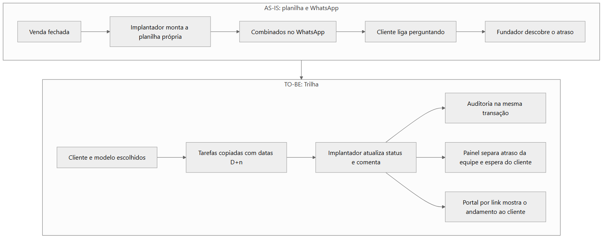

# 01 · Visão e discovery

**Objetivo:** mostrar como o problema foi entendido, quem foi ouvido, o que ficou dentro e fora do escopo e como o sucesso seria medido.
**Data:** 2026-10-24 · **Status:** concluído
Relacionados: [Índice do ciclo de vida](README.md) · [02 Planejamento e Scrum](02-planejamento-e-scrum.md) · [03 Requisitos](03-requisitos-e-rastreabilidade.md) · [Episódio 1: Discovery](../01-discovery/README.md)

## Contexto de negócio

A Rota Fácil Software é uma software house fictícia de cerca de 12 pessoas. Vende um sistema de gestão para pequenas distribuidoras e conduz cada implantação, de 4 a 8 semanas, com planilhas, WhatsApp e e-mail. A carteira do cenário tem cerca de 45 clientes ativos e três vendas novas por mês ([empresa](../01-discovery/02-empresa-rota-facil.md)).

Antes de chegar à implantação, o brainstorm comparou cinco ideias de produto e a hipótese de que a dor estava no suporte pós-venda. Ela não se confirmou: a raiz estava na implantação ([brainstorm](../01-discovery/01-brainstorm-e-escolha.md), [problemas priorizados](../01-discovery/08-problemas-priorizados.md)).

## Partes interessadas

| Papel | Interesse | Papel no sistema | Participou de |
|---|---|---|---|
| Fundador | Ver o que está atrasado sem pedir relatório e deixar de ser o gerente de cada implantação | Administrador | [Reunião 1](../01-discovery/04-reuniao-1-kickoff-fundador.md), [reunião 4](../04-prototipo/02-reuniao-4-validacao.md) |
| Líder de implantação | Padronizar o processo e distribuir a carga | Administrador | [Reunião 2](../01-discovery/05-reuniao-2-lideranca-e-implantador.md), reuniões 4 e 5 |
| Implantador | Atualizar tarefas sem retrabalho e ter o histórico do que combinou | Implantador | Reunião 2 |
| Suporte e Customer Success | Consultar o que foi combinado sem perguntar ao implantador | Implantador (leitura e comentários) | [Reunião 3](../01-discovery/06-reuniao-3-suporte-e-cliente.md) |
| Cliente da distribuidora | Saber o que falta e o que depende dele, sem criar conta | Leitura por link | Reunião 3 |

As cinco reuniões desta tabela são simuladas; os participantes são papéis do cenário ([personas](../01-discovery/03-stakeholders-e-personas.md)).

## Perguntas de discovery

| Reunião | Pergunta | O que mudou |
|---|---|---|
| 1 | Qual foi a última implantação que deu dor de cabeça? | Foco em implantação, não em chamados nem cobrança |
| 1 | Qual é o orçamento e o prazo? | Teto de cerca de R$ 100/mês, cerca de 3 meses, um desenvolvedor |
| 1 | O que seria sucesso daqui a seis meses? | O fundador deixar de ser o gerente de projeto das implantações (R1-08) |
| 1 | O painel responderia a quê? | "O que está atrasado, de quem e há quanto tempo" |
| 2 | Como a implantação funciona, do começo ao fim? | Etapas do modelo padrão e o estado "aguardando cliente" |
| 3 | Como o cliente acompanha hoje? | Portal por link, sem cadastro (R3-05) |

## Problema central e proposta de valor

**Problema.** A equipe não tem uma visão única das implantações: o atraso aparece quando o cliente liga, os combinados ficam no WhatsApp e cada implantador segue um roteiro próprio. O discovery os organizou em sete problemas, P1 a P7, ordenados por impacto e por caber no orçamento.

**Proposta de valor.** Modelo padrão com prazos D+n a partir do kickoff, painel que separa atraso da equipe de espera do cliente, histórico de alterações e portal de leitura por link ([visão do produto](../02-definicao/01-visao-e-metas.md)).

## Do processo atual ao processo com a Trilha

*Fonte editável: [as-is-to-be.mmd](diagramas/as-is-to-be.mmd). O AS-IS detalhado está em [processo AS-IS](../01-discovery/07-processo-as-is.md).*

## Escopo e fora de escopo

| Dentro do MVP | Fora do MVP, com o motivo |
|---|---|
| Papéis Administrador e Implantador; cliente somente leitura por link | Notificações por WhatsApp e e-mail: custo por conversa, fora do teto (R1-05, R1-06) |
| Clientes, modelos com D+n, implantação com datas calculadas, status, comentários e auditoria | Integração com CRM e ERP: sem sistema de origem definido |
| Painel, regra de atraso configurável, fila de pendências | Multiempresa: dobra a complexidade de dados e permissões |
| Portal por token, seed de demonstração | Dependência entre tarefas, subtarefas e anexos: contradição resolvida a favor do simples |

Lista completa em [priorização e escopo](../02-definicao/05-priorizacao-e-escopo.md).

## Restrições, premissas e dependências

| Tipo | Registro |
|---|---|
| Financeira | Custo recorrente de cerca de R$ 100/mês no máximo (R1-05) |
| Negócio | Prazo de cerca de 3 meses; poucos implantadores, então a ferramenta não pode dar trabalho extra de preenchimento |
| Técnica | Um desenvolvedor; clientes sem e-mail corporativo, então sem conta para o cliente |
| Operacional | Fundador ainda participa de implantações dos clientes maiores |
| Premissa | Cada implantação parte de um modelo padrão; a planilha atual é a referência do processo |
| Dependência | Revisão dos modelos pela líder de implantação antes da entrada em uso |

## Riscos iniciais

| ID | Risco | Mitigação registrada |
|---|---|---|
| RK-01 | Escopo crescer por pedidos de detalhe | Escopo fechado e fila de v2 |
| RK-02 | Uma pessoa só no desenvolvimento | Ordem de corte definida desde o início |
| RK-08 | Equipe não preencher o sistema | Tarefas nascem do modelo e fila de pendências como benefício imediato |

Os oito riscos estão em [riscos](../02-definicao/07-riscos.md).

## Critérios de sucesso e indicadores

As cinco metas H1 a H5 e os indicadores I1 a I6 são hipóteses de medição; nenhuma foi medida ([visão e metas](../02-definicao/01-visao-e-metas.md), [indicadores](../07-pos-go-live/indicadores.md)).

| Meta | Indicador proposto |
|---|---|
| H1: o fundador deixa de depender da reunião de segunda | I1: aberturas do painel por semana |
| H2: menos consultas "como está minha implantação?" | I2 e I3: mensagens no WhatsApp e links gerados |
| H3: toda implantação nova parte de um modelo | I4: proporção criada a partir de modelo |
| H4: combinados registrados | I5: comentários por implantação |
| H5: tempo de implantação mais previsível | I6: prazo planejado contra o real |
