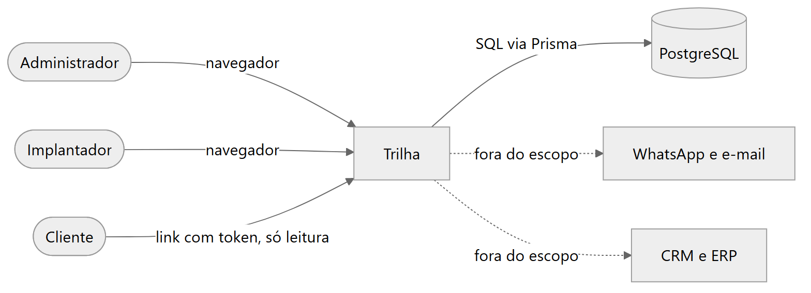
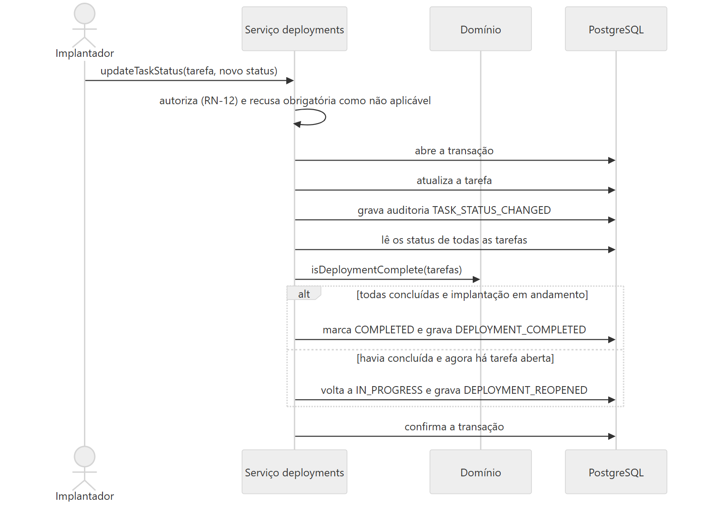
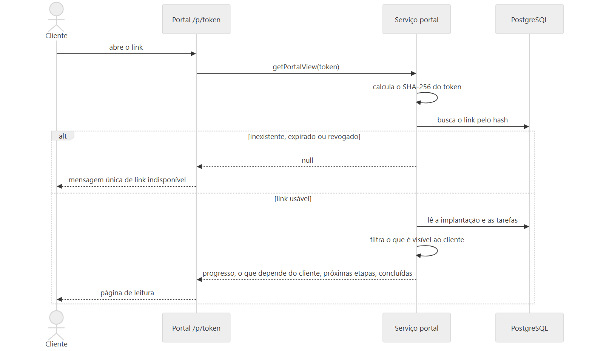
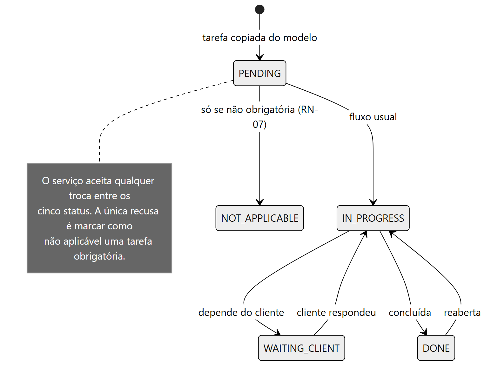
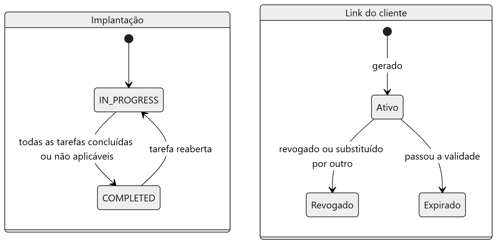

# 04 · Arquitetura e decisões

**Objetivo:** mostrar o sistema visto de fora e por dentro, os fluxos principais, os estados do domínio e as decisões que os sustentam.
**Data:** 2026-10-24 · **Status:** concluído
Relacionados: [Índice do ciclo de vida](README.md) · [05 Modelo de dados](05-modelo-de-dados.md) · [03 Requisitos](03-requisitos-e-rastreabilidade.md) · [Episódio 3: Arquitetura](../03-arquitetura/README.md) · [Diagramas](diagramas/README.md)

Os diagramas deste documento descrevem o código atual (`src/`) e o [schema](../../prisma/schema.prisma). Integrações com WhatsApp, e-mail, CRM e ERP não existem; aparecem pontilhadas só para marcar o que ficou fora.

## Contexto

*Fonte editável: [contexto.mmd](diagramas/contexto.mmd).*

## Contêineres e componentes

*Fonte editável: [containers.mmd](diagramas/containers.mmd).*

| Componente | Pasta | Responsabilidade |
|---|---|---|
| Páginas e Server Actions | `src/app` | Autenticam, chamam um serviço e tratam o erro; não têm regra de negócio |
| Portal por token | `src/app/p/[token]` | Página de leitura do cliente; token inválido, expirado e revogado respondem igual |
| Healthcheck | `src/app/api/health` | Verifica a conexão com o banco |
| Serviços | `src/server/services` | Um caso de uso por função: validam com Zod, autorizam, gravam em transação e auditam |
| Domínio puro | `src/domain` | Prazo, atraso, progresso, permissões e token, sem banco nem framework |
| Banco | PostgreSQL com Prisma | 13 tabelas e uma migration versionada |

Detalhes da camada de serviços em [ADR-008](../03-arquitetura/adr/008-camada-de-servicos.md).

## Fluxos principais

### Criar uma implantação

*Fonte editável: [seq-criar-implantacao.mmd](diagramas/seq-criar-implantacao.mmd).*

### Atualizar uma tarefa com auditoria

*Fonte editável: [seq-status-auditoria.mmd](diagramas/seq-status-auditoria.mmd).*

### Acessar o portal por token

*Fonte editável: [seq-portal.mmd](diagramas/seq-portal.mmd).*

## Estados do domínio

*Fonte editável: [estado-tarefa.mmd](diagramas/estado-tarefa.mmd). O serviço aceita qualquer troca entre os cinco status; a única recusa é marcar como não aplicável uma tarefa obrigatória (RN-07).*

*Fonte editável: [estado-implantacao-e-link.mmd](diagramas/estado-implantacao-e-link.mmd). "Atrasada" não é um estado gravado: é calculada na leitura (RN-04).*

## Decisões (ADRs)

| ADR | Decisão | Alternativas consideradas | Custo aceito | Quando mudaria |
|---|---|---|---|---|
| [001](../03-arquitetura/adr/001-framework.md) | Next.js (App Router) com TypeScript | React com API Express; Remix; Rails ou Django | Acoplamento ao cache e ao ecossistema Next | Se a API precisasse atender outros clientes |
| [002](../03-arquitetura/adr/002-autenticacao.md) | Sessão própria em cookie opaco e tabela `Session`, senha com scrypt | Auth.js; Clerk ou Auth0 | Uma consulta ao banco por requisição; sessão feita à mão exige disciplina; argon2id deixado de lado para evitar dependência nativa | Se precisasse de login social, SSO ou MFA |
| [003](../03-arquitetura/adr/003-banco-e-orm.md) | PostgreSQL com Prisma | Drizzle ou Kysely; SQLite; MongoDB | Consultas de relatório menos transparentes; passo de geração do cliente | Se o desempenho de relatórios virasse problema |
| [004](../03-arquitetura/adr/004-tarefas-e-prazos-relativos.md) | Modelo copiado na criação; prazo D+n com datas civis | Referência viva ao modelo; grafo de dependências | Dados duplicados; corrigir o modelo não corrige implantações existentes | Se dependências entre tarefas fossem frequentes |
| [005](../03-arquitetura/adr/005-auditoria.md) | Registro explícito na camada de serviços, na mesma transação | Triggers; event sourcing; extensão do Prisma | Alteração direta no banco não é registrada; imutabilidade por convenção | Com exigência de conformidade forte |
| [006](../03-arquitetura/adr/006-controle-de-acesso.md) | Função `can(actor, action, resource)` e guarda em todo serviço | Só esconder botões; CASL; Row Level Security | Esquecer o `assertCan` em um serviço novo seria uma falha silenciosa | Com mais papéis ou permissão por campo |
| [007](../03-arquitetura/adr/007-portal-por-token.md) | Token opaco de 32 bytes, só o SHA-256 no banco, somente leitura | Login; JWT no link; código curto com dado pessoal | Quem tem o link acessa o conteúdo; sem limite de requisições no MVP | Se o portal mostrasse dados financeiros |
| [008](../03-arquitetura/adr/008-camada-de-servicos.md) | Três camadas: domínio, serviços e app | Lógica nas Server Actions; API REST completa | Testes de integração não cobrem a fronteira HTTP | Se surgisse um cliente externo da API |

## Requisitos de qualidade

| Atributo | Como a arquitetura responde | Evidência |
|---|---|---|
| Segurança | Autorização central no servidor; token só como hash; senha com scrypt; entrada validada com Zod | [Segurança e privacidade](../03-arquitetura/seguranca-e-privacidade.md), [ADR-006](../03-arquitetura/adr/006-controle-de-acesso.md) |
| Consistência | Mudança, auditoria e conclusão da implantação na mesma transação | [ADR-005](../03-arquitetura/adr/005-auditoria.md) |
| Manutenibilidade | Regras em funções puras, testáveis sem banco | [ADR-008](../03-arquitetura/adr/008-camada-de-servicos.md), [testes unitários](../../tests/unit/progress.test.ts) |
| Observabilidade | Logs em JSON sem dados pessoais e `/api/health` | [Runbook](../07-pos-go-live/runbook.md) |
| Desempenho | Meta definida como hipótese; não medida | [RNF-01](../02-definicao/02-requisitos.md), [limitações](../05-qualidade/03-limitacoes-conhecidas.md) |
| Disponibilidade | Sem SLA; ambiente local | [RNF-08](../02-definicao/02-requisitos.md) |

## Consequências futuras

Se a Trilha ganhasse um cliente externo da API, os serviços já estão separados da interface e poderiam ser expostos em route handlers. Se virasse produto para outras software houses, o modelo de dados precisaria de multiempresa, hoje fora do escopo.
