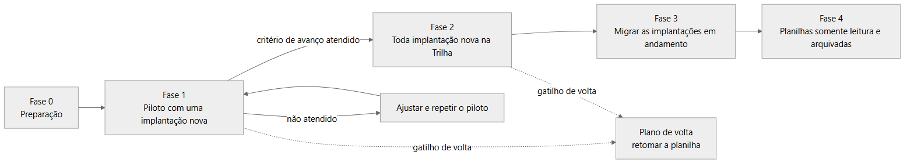

# 08 · Implantação, operação e adoção

**Objetivo:** documentar como a Trilha entraria em uso na Rota Fácil e como seria operada, separando o que existe e foi executado do que é plano.
**Data:** 2026-10-24 · **Status:** concluído
Relacionados: [Índice do ciclo de vida](README.md) · [06 Desenvolvimento](06-desenvolvimento-e-configuracao.md) · [09 Evolução](09-evolucao-e-roadmap.md) · [Episódio 6: Treinamento e rollout](../06-treinamento-e-rollout/README.md) · [Episódio 7: Pós-go-live](../07-pos-go-live/README.md)

## Executado e planejado

| Item | Situação | Registro |
|---|---|---|
| Execução local com banco em Docker | Existe e foi executada | [CONTRIBUTING](../../CONTRIBUTING.md), [CI](../05-qualidade/05-execucao-ci-2026-10-24.md) |
| CI no GitHub | Existe e foi executada | [ci.yml](../../.github/workflows/ci.yml) |
| Deploy de aplicação em ambiente de uso | Não existe | Configuração de deploy criada e removida: [06](06-desenvolvimento-e-configuracao.md#histórico-de-mudanças-relevantes) |
| Rollout em fases | Plano, não executado | [Plano de rollout](../06-treinamento-e-rollout/01-plano-de-rollout.md) |
| Plano de volta | Plano, não executado | [Checklist e plano de volta](../06-treinamento-e-rollout/02-checklist-de-entrada-em-uso.md) |
| Treinamento | Guias escritos, treinamento não executado | [Guia do implantador](../06-treinamento-e-rollout/04-guia-treinamento-implantador.md), [guia do cliente](../06-treinamento-e-rollout/05-guia-rapido-cliente.md) |
| Comunicação | Plano, não executado | [Plano de comunicação](../06-treinamento-e-rollout/06-plano-de-comunicacao.md) |
| Operação | Runbook escrito para um ambiente em uso; não houve ambiente em uso | [Runbook](../07-pos-go-live/runbook.md) |
| Indicadores de adoção | Hipóteses, sem medição | [Indicadores](../07-pos-go-live/indicadores.md) |

## Arquitetura de implantação

Hoje a aplicação é um serviço Node.js (Next.js) que se conecta a um PostgreSQL. Na máquina de desenvolvimento o banco roda em um contêiner Docker; na CI, como serviço do job. Não há ambiente de homologação nem de produção.

Para uma entrada em uso, o runbook assume o mesmo desenho: um serviço Node.js, um PostgreSQL com backup periódico e o endereço público configurado em `APP_URL`, usado para montar o link do portal. As dependências externas são só o banco; não há e-mail, WhatsApp, CRM ou ERP.

| Ambiente | Banco | Configuração |
|---|---|---|
| Desenvolvimento | PostgreSQL em Docker | `.env` local, fora do Git |
| CI | PostgreSQL como serviço do job | Variáveis no próprio workflow |
| Entrada em uso (plano) | PostgreSQL com backup periódico | `DATABASE_URL`, `AUTH_SECRET` e `APP_URL` definidos no ambiente |

## Plano de implantação e rollout

*Plano, não executado. Fonte editável: [rollout.mmd](diagramas/rollout.mmd).*

| Fase | O que acontece | Critério para avançar (meta, não resultado) |
|---|---|---|
| 0. Preparação | App e banco no ar, contas criadas, modelos revisados pela líder, implantador treinado | Checklist de entrada em uso completo |
| 1. Piloto | Uma implantação nova usa a Trilha do kickoff ao go-live; a planilha continua em paralelo só nesse cliente | O implantador atualiza as tarefas sem ajuda constante; o cliente abre o portal; a líder vê o atraso no painel sem perguntar |
| 2. Ampliação | Toda implantação nova nasce na Trilha | Duas ou mais implantações novas rodando sem abandono do preenchimento |
| 3. Migração | As implantações em andamento são recriadas na Trilha com o kickoff original | Todas na Trilha; a reunião de segunda usa o painel |
| 4. Encerramento das planilhas | Planilhas somente leitura e depois arquivadas | Fase 3 estável |

## Plano de rollback

Gatilhos para voltar à planilha: perda ou corrupção de dados, falha de autorização ou link vazado que não se contém revogando, sistema fora do ar além do que a equipe contorna, ou piloto prejudicando a implantação do cliente.

| Situação | Ação | Perda esperada |
|---|---|---|
| Dados corrompidos | Restaurar o último backup do banco ([runbook](../07-pos-go-live/runbook.md)) | Alterações desde o backup |
| Link de cliente vazado | Revogar o link e gerar outro | Nenhuma |
| Sistema inviável | Retomar a planilha do cliente do piloto; a Trilha vira só consulta | Registros feitos só na Trilha precisam ser copiados à mão |
| Migration com defeito | Nova migration que desfaz, ou backup anterior com o código na versão anterior | Depende do caminho |

Voltar é barato no piloto porque a planilha continua sendo preenchida em paralelo.

## Migração e preparação dos dados

| Dado | Tratamento planejado |
|---|---|
| Clientes | Cadastro na Trilha (empresa, contato, plano e data de contrato) |
| Modelos | Revisados pela líder antes do piloto; ajustes entram no modelo, não nas implantações em andamento |
| Implantações em andamento | Recriadas na fase 3 com o kickoff original |
| Dados de demonstração | Seed apaga e recria as tabelas; não deve ser usado em ambiente com dados reais |

## Treinamento, onboarding e Customer Success

| Público | Material | Conteúdo | Status |
|---|---|---|---|
| Implantador | [Guia de treinamento](../06-treinamento-e-rollout/04-guia-treinamento-implantador.md) | Cerca de 45 minutos, do login ao link do cliente, com exercício final | Guia escrito; treinamento não executado |
| Cliente | [Guia rápido](../06-treinamento-e-rollout/05-guia-rapido-cliente.md) | Uma página: como ler o portal e o que depende dele | Guia escrito; não enviado |
| Equipe | [Plano de comunicação](../06-treinamento-e-rollout/06-plano-de-comunicacao.md) | O que dizer a quem e quando, com mensagens prontas | Plano |

A regra de ouro do treinamento é registrar como comentário na tarefa tudo o que se combina com o cliente, porque é o histórico que o suporte consulta quando o cliente liga.

## Monitoramento, logs e suporte

| Item | Existe hoje | Observação |
|---|---|---|
| Healthcheck | Sim | `/api/health` verifica o banco |
| Logs em JSON | Sim | Eventos como `login_failed`, `access_denied`, `unexpected_error` e `healthcheck_database_failed`, sem dados pessoais nem segredos |
| Alertas | Não | Sem ferramenta de monitoramento |
| Suporte | Plano | [Runbook](../07-pos-go-live/runbook.md): papéis, primeiros passos, problemas comuns, backup, reversão de migration e rotina |
| Severidade | Proposta | Alta (fora do ar ou dado exposto), média (uma tela com erro), baixa (texto ou melhoria); sem SLA |

## Indicadores de adoção e critérios de sucesso

Nenhum foi medido. Os indicadores abaixo são hipóteses de medição.

| Indicador | Pergunta | Origem do dado | Observação |
|---|---|---|---|
| I1: aberturas do painel por semana | O fundador usa o painel? | Logs de acesso | Hoje não registrados: exigiria um evento |
| I2: consultas "como está minha implantação?" | O portal reduz as consultas? | Contagem manual no WhatsApp | Antes e depois do piloto |
| I3: implantações com link gerado | O implantador oferece o portal? | Tabela `PortalLink` | Link gerado não é link aberto |
| I5: comentários por implantação | Os combinados estão registrados? | Tabela `Comment` | Quantidade não é qualidade |
| I6: prazo planejado contra o real | O tempo ficou mais previsível? | `kickoffDate`, último prazo e `completedAt` | Poucas implantações por trimestre |

## Riscos operacionais e continuidade

| Risco | Tratamento |
|---|---|
| RK-08: a equipe não preencher o sistema | Tarefas nascem do modelo; fila de pendências como benefício imediato; planilha em paralelo no piloto |
| RK-07: o cliente não usar o portal | Link curto, desenho para celular e mensagem pronta para enviar |
| Banco corrompido ou perdido | Backup com `pg_dump`, antes de migrations arriscadas, e teste de restauração antes de depender dele |
| Sem monitoramento de disponibilidade | Healthcheck manual a cada atualização; sem SLA |
| Portal sem limite de requisições | Limitação registrada no [ADR-007](../03-arquitetura/adr/007-portal-por-token.md); tratar antes de qualquer exposição pública |
