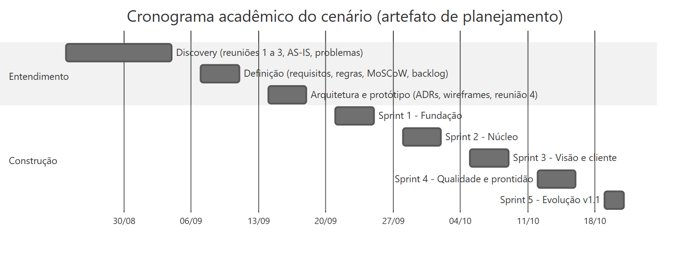

# Ciclo de vida da Trilha

**Objetivo:** reunir, em uma sequência, como o onboarding de clientes foi entendido, planejado, projetado, construído, testado, preparado para entrar em uso e evoluído.
**Data:** 2026-10-24 · **Status:** concluído
Relacionados: [README](../../README.md) · [Guia da série](../INDEX.md) · [Glossário](../GLOSSARIO.md)

## Como ler os registros

Cada informação pertence a um de três tipos. O tipo aparece nas tabelas e é explicado na [nota de contexto acadêmico](../../README.md#nota-de-contexto-acadêmico).

| Tipo | O que é | Exemplos |
|---|---|---|
| Evidência observada | Confirmada no repositório ou obtida por execução verificável | Commits, tags, execuções da CI, resultado dos testes, schema, código |
| Artefato de planejamento | Elaborado para compor o cenário do estudo de caso | Atas das reuniões, cronograma acadêmico, planejamento e retrospectiva das sprints |
| Resultado ilustrativo | Número ou resultado usado só para exemplificar | Dados do seed, o "47 dias" do painel |

## As fases

*Fonte editável: [ciclo-de-vida.mmd](diagramas/ciclo-de-vida.mmd).*

| Fase | Documento | Evidência principal |
|---|---|---|
| A. Discovery | [01 Visão e discovery](01-visao-e-discovery.md) | [Reuniões 1 a 3](../01-discovery/README.md) |
| B. Requisitos | [03 Requisitos e rastreabilidade](03-requisitos-e-rastreabilidade.md) | [Matriz de rastreabilidade](../02-definicao/08-rastreabilidade.md) |
| C. Planejamento | [02 Planejamento e Scrum](02-planejamento-e-scrum.md) · [sprints](sprints/README.md) | [Backlog](../02-definicao/06-backlog-e-sprints.md) |
| D. Arquitetura | [04 Arquitetura e ADRs](04-arquitetura-e-adrs.md) | [ADR-001 a ADR-008](../03-arquitetura/README.md) |
| E. Dados | [05 Modelo de dados](05-modelo-de-dados.md) | [schema.prisma](../../prisma/schema.prisma) |
| F. Desenvolvimento | [06 Desenvolvimento e configuração](06-desenvolvimento-e-configuracao.md) | [CHANGELOG](../../CHANGELOG.md) · [workflow da CI](../../.github/workflows/ci.yml) |
| G. Qualidade | [07 Testes e qualidade](07-testes-e-qualidade.md) | [Execução na CI](../05-qualidade/05-execucao-ci-2026-10-24.md) |
| H. Implantação | [08 Implantação e operação](08-implantacao-e-operacao.md) | [Rollout](../06-treinamento-e-rollout/README.md) · [Runbook](../07-pos-go-live/runbook.md) |
| I. Evolução | [09 Evolução e roadmap](09-evolucao-e-roadmap.md) | [Roadmap](../07-pos-go-live/roadmap.md) |

## Linha do tempo

O cronograma acadêmico organiza o cenário. As datas do histórico Git e da CI são as dos registros e não seguem o cronograma.

*Cronograma acadêmico (artefato de planejamento). Fonte: [cronograma-academico.mmd](diagramas/cronograma-academico.mmd).*

*Histórico observado no Git e na CI. Fonte: [historico-observado.mmd](diagramas/historico-observado.mmd).*

## Marcos observados

| Data | Marco | Registro |
|---|---|---|
| 2026-10-22 | v1.0.0 e v1.1.0 marcadas | Tags `v1.0.0` (`e71efb7`) e `v1.1.0` (`a16b9bf`) |
| 2026-10-23 | Primeira execução da CI, com falha no E2E do portal (D6) | [Run 39984884953](https://github.com/Joaogabrielmaia/Customer-onboarding-platform/actions/runs/39984884953), commit `453f1e1` |
| 2026-10-24 | D6 corrigido e CI verde | [Run 40098547445](https://github.com/Joaogabrielmaia/Customer-onboarding-platform/actions/runs/40098547445), commit `366f1f5`; PR 1 mesclado em `a9066fe` |
| 2026-10-24 | README como apresentação de competência técnica | PR 2, `904ce09` |

## Índice

- [Reuniões e atas](reunioes/README.md)
- [Sprints](sprints/README.md)
- [Diagramas](diagramas/README.md)
- Documentos: [01](01-visao-e-discovery.md) · [02](02-planejamento-e-scrum.md) · [03](03-requisitos-e-rastreabilidade.md) · [04](04-arquitetura-e-adrs.md) · [05](05-modelo-de-dados.md) · [06](06-desenvolvimento-e-configuracao.md) · [07](07-testes-e-qualidade.md) · [08](08-implantacao-e-operacao.md) · [09](09-evolucao-e-roadmap.md)
