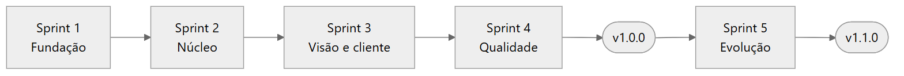

# Sprints

**Objetivo:** reunir as cinco sprints do cenário, cada uma com objetivo, escopo, critérios de conclusão, planejamento, review, retrospectiva e evidências.
**Data:** 2026-10-24 · **Status:** concluído
Relacionados: [Índice do ciclo de vida](../README.md) · [02 Planejamento e Scrum](../02-planejamento-e-scrum.md)

As janelas das sprints pertencem ao cronograma acadêmico, um artefato de planejamento. Os commits citados em cada página são observados e têm a data do histórico Git, 2026-10-22 para todo o desenvolvimento.

| Sprint | Janela acadêmica | Objetivo | Release |
|---|---|---|---|
| [1 Fundação](sprint-1-fundacao.md) | 21 a 25/09/2026 | Login com papéis, clientes, usuários e seed base | v1.0.0 |
| [2 Núcleo](sprint-2-nucleo.md) | 28/09 a 02/10/2026 | Modelo, implantação, tarefas, comentários e auditoria | v1.0.0 |
| [3 Visão e cliente](sprint-3-visao-e-cliente.md) | 05 a 09/10/2026 | Painel, atraso, pendências e portal por token | v1.0.0 |
| [4 Qualidade e prontidão](sprint-4-qualidade.md) | 12 a 16/10/2026 | CI, E2E, defeitos, UAT e planos de entrada em uso | v1.0.0 |
| [5 Evolução v1.1](sprint-5-evolucao.md) | 19 a 21/10/2026 | Exportação em CSV | v1.1.0 |

## Fluxo entre as sprints

*Fonte editável: [fluxo-das-sprints.mmd](../diagramas/fluxo-das-sprints.mmd).*
