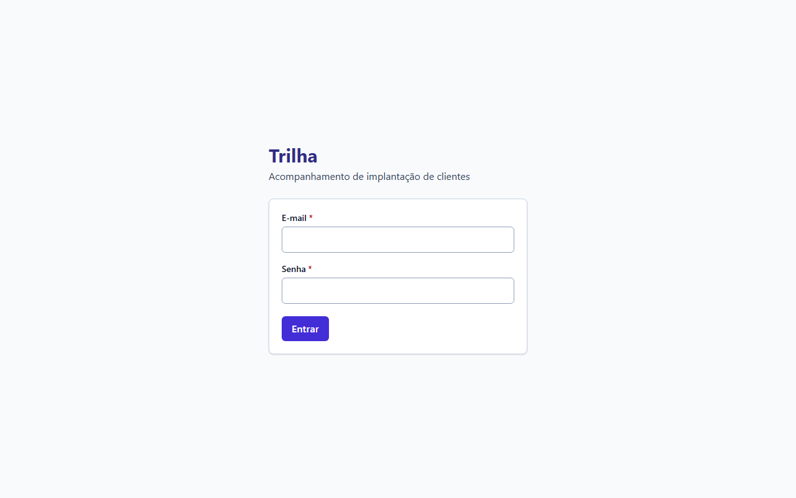
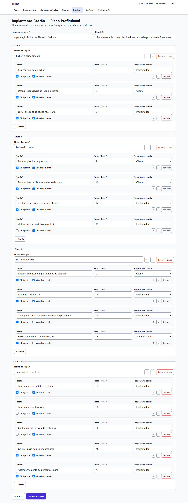
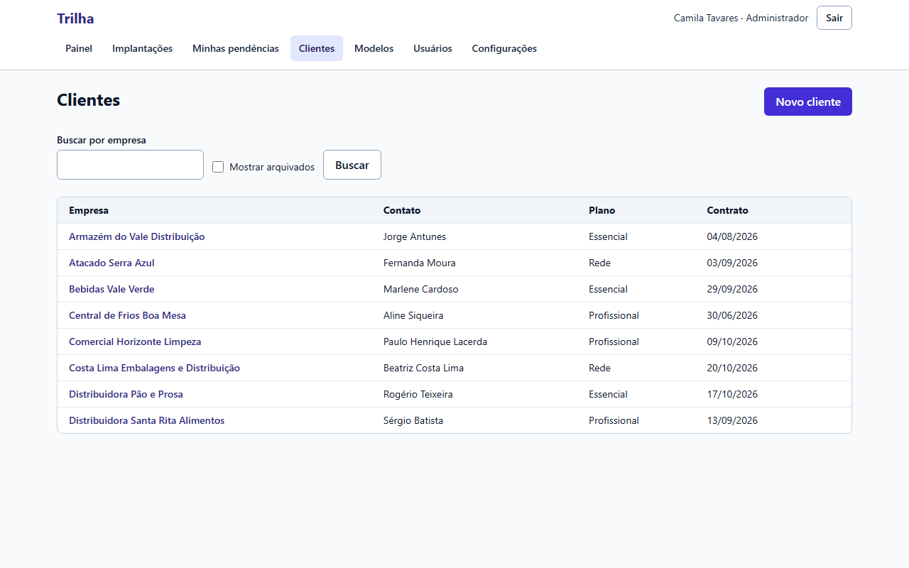
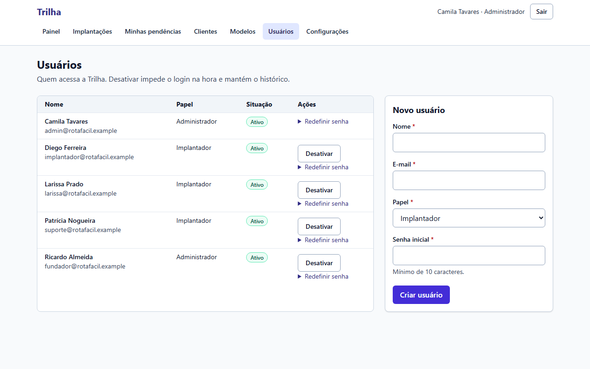
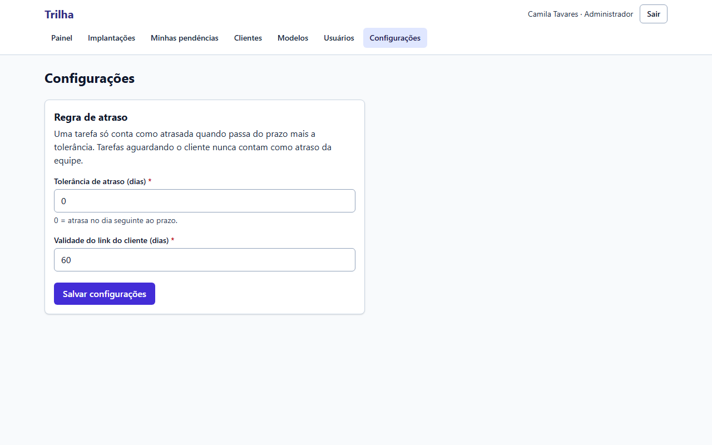
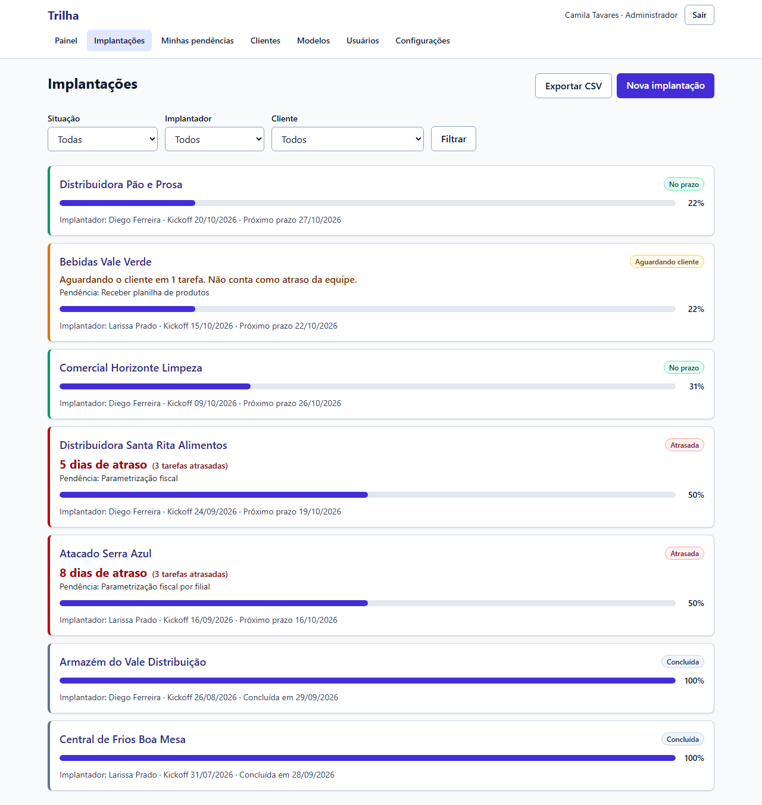
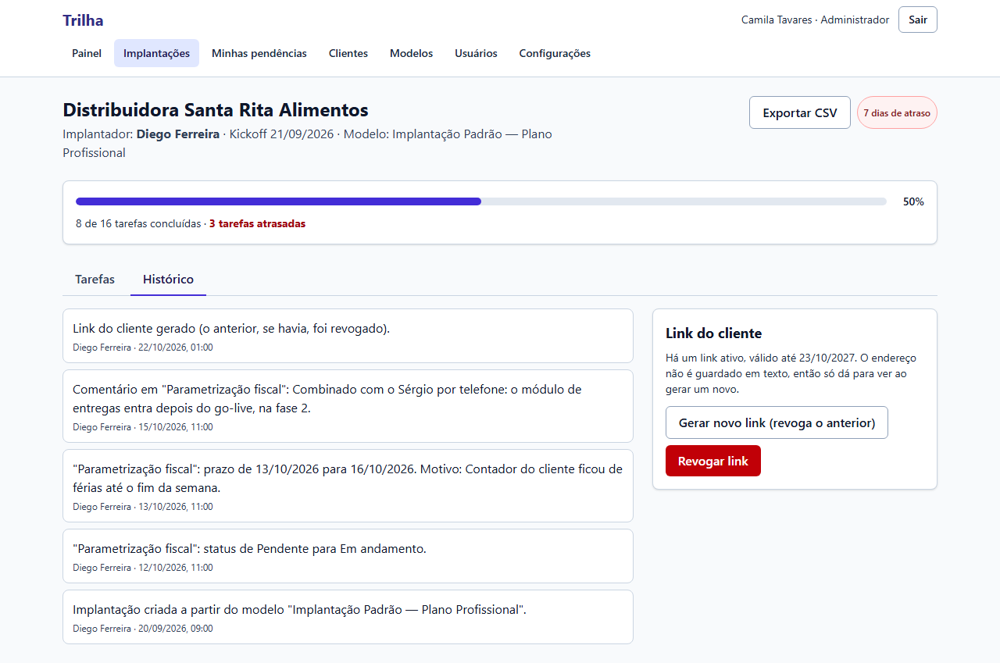
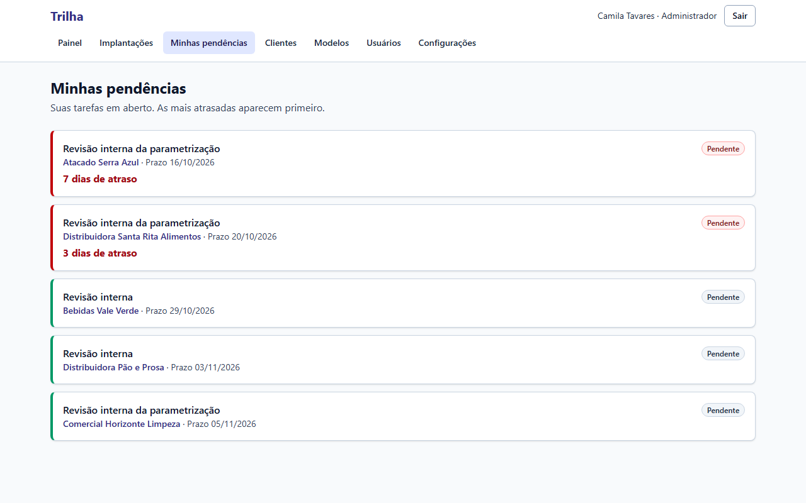
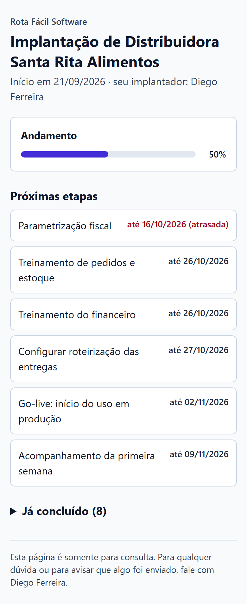
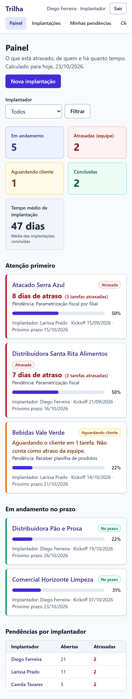

# Galeria de telas

**Objetivo:** mostrar as telas da Trilha na ordem de uma implantação, do login ao portal do cliente.
**Data:** 2026-10-24 · **Status:** concluído
Relacionados: [Guia da série](../INDEX.md) · [Wireframes](../04-prototipo/01-wireframes.md) · [Glossário](../GLOSSARIO.md)

Os prints são gerados pelo Playwright sobre dados de exemplo, em banco separado (`npm run screenshots`). O "47 dias" do painel é a média das implantações concluídas do seed de demonstração, não uma medição. Os prints de Usuários, Configurações e da lista de Implantações foram capturados em 2026-10-24; as datas do seed são relativas ao dia da captura, por isso os dias de atraso diferem de um print para outro.

## 1. Login

**O que se vê:** título Trilha, os campos E-mail e Senha e o botão Entrar. · **Por que importa:** a sessão é própria, gravada no banco, o que permite sair e desativar usuário na hora ([ADR-002](../03-arquitetura/adr/002-autenticacao.md)).

## 2. Modelo de implantação

**O que se vê:** o modelo "Implantação Padrão — Plano Profissional", com quatro etapas e 16 tarefas, cada uma com prazo D+n, responsável padrão e as marcas Obrigatória e Visível ao cliente. · **Por que importa:** a tela avisa que alterar o modelo não muda as implantações já criadas, porque a implantação recebe uma cópia ([ADR-004](../03-arquitetura/adr/004-tarefas-e-prazos-relativos.md)).

## 3. Clientes

**O que se vê:** oito empresas fictícias com contato, plano (Essencial, Profissional ou Rede) e data de contrato, busca por empresa e opção de mostrar arquivados. · **Por que importa:** cadastro de cliente faz parte do escopo do MVP ([priorização e escopo](../02-definicao/05-priorizacao-e-escopo.md)).

## 4. Usuários

**O que se vê:** cinco usuários fictícios, com papel (Administrador ou Implantador) e situação Ativo, os botões Desativar e Redefinir senha, e o formulário Novo usuário com nome, e-mail, papel e senha inicial (mínimo de 10 caracteres). · **Por que importa:** a tela diz que desativar impede o login na hora e mantém o histórico, o que a sessão própria permite ([ADR-002](../03-arquitetura/adr/002-autenticacao.md)).

## 5. Configurações

**O que se vê:** a regra de atraso, com tolerância de 0 dia e validade do link do cliente de 60 dias, e o aviso de que tarefa aguardando o cliente nunca conta como atraso da equipe. · **Por que importa:** a regra de atraso é configurável, como previsto no escopo do MVP ([priorização e escopo](../02-definicao/05-priorizacao-e-escopo.md)); 60 dias é a validade padrão do link ([ADR-007](../03-arquitetura/adr/007-portal-por-token.md)).

## 6. Nova implantação

**O que se vê:** escolha de cliente, modelo e data do kickoff, e uma prévia com as 16 tarefas e a data real ao lado de cada D+n, de D+0 a D+47. · **Por que importa:** os prazos são calculados a partir do kickoff antes de criar, e a implantação criada não muda se o modelo mudar ([ADR-004](../03-arquitetura/adr/004-tarefas-e-prazos-relativos.md)).

## 7. Lista de implantações

**O que se vê:** filtros por situação, implantador e cliente, os botões Exportar CSV e Nova implantação, e sete implantações: duas no prazo, uma aguardando cliente, duas atrasadas (5 e 8 dias) e duas concluídas. · **Por que importa:** a exportação da lista respeita os filtros da tela, entregue na v1.1.0 ([CHANGELOG](../../CHANGELOG.md)).

## 8. Detalhe da implantação

**O que se vê:** a Distribuidora Santa Rita Alimentos com 8 de 16 tarefas concluídas, 3 atrasadas, status por tarefa, o prazo da parametrização fiscal com o original (13/10/2026) e o formulário de ajuste com motivo, além do painel do link do cliente. · **Por que importa:** o ajuste de prazo exige motivo e fica registrado ([regras de negócio](../02-definicao/03-regras-de-negocio.md)).

## 9. Histórico

**O que se vê:** cinco registros com autor e horário: criação a partir do modelo, mudança de status, ajuste de prazo com motivo, comentário e geração do link do cliente. · **Por que importa:** a auditoria é gravada na mesma transação da mudança ([ADR-005](../03-arquitetura/adr/005-auditoria.md)).

## 10. Minhas pendências

**O que se vê:** cinco tarefas em aberto, com as duas atrasadas (7 e 3 dias) primeiro. · **Por que importa:** responde ao problema de implantadores que esquecem pendências ([P7](../01-discovery/08-problemas-priorizados.md)).

## 11. Painel

**O que se vê:** cartões com 5 em andamento, 2 atrasadas (equipe), 1 aguardando cliente, 2 concluídas e 47 dias de tempo médio; a lista "Atenção primeiro" e as pendências por implantador. A implantação aguardando cliente diz que não conta como atraso da equipe. · **Por que importa:** é a resposta a "o que está atrasado, de quem e há quanto tempo" ([problemas P1 e P4](../01-discovery/08-problemas-priorizados.md)).

## 12. Portal do cliente

**O que se vê:** progresso de 50%, seis próximas etapas com prazo (a primeira marcada como atrasada), a seção "Já concluído (8)" e o aviso de que a página é só para consulta. · **Por que importa:** o cliente acompanha sem criar conta, no lugar do WhatsApp automático que o custo inviabilizou ([reunião 1](../01-discovery/04-reuniao-1-kickoff-fundador.md), [ADR-007](../03-arquitetura/adr/007-portal-por-token.md)).

## 13. Portal no celular

**O que se vê:** a mesma página em largura de celular, com as etapas empilhadas. · **Por que importa:** há um teste E2E que verifica a ausência de rolagem horizontal em tela pequena ([rastreabilidade, TC-34](../02-definicao/08-rastreabilidade.md)).

## 14. Painel no celular

**O que se vê:** os cartões em duas colunas e as implantações em uma coluna, com o menu cortado à direita. · **Por que importa:** a rolagem horizontal no celular foi o defeito D3, corrigido ([resultado da execução](../05-qualidade/02-resultado-da-ultima-execucao.md)).
